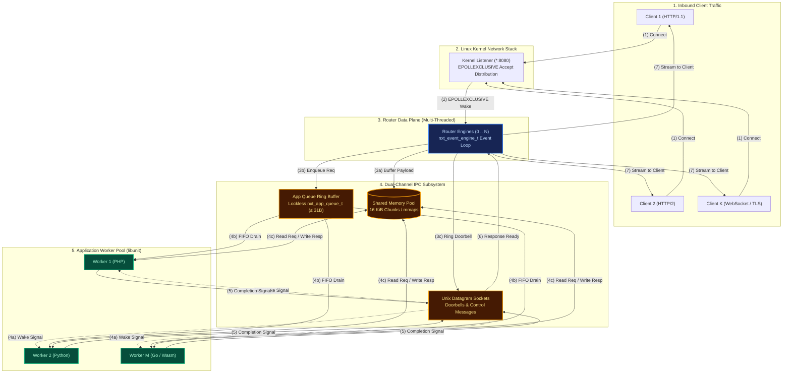

# FreeUnit Formal & Discrete-Event Behavioral Model

[](https://github.com/andypost/freeunit-model/actions/workflows/ci.yml)
[](https://github.com/andypost/freeunit-model/actions/workflows/pages.yml)
[](https://andypost.github.io/freeunit-model/)
[](https://opensource.org/licenses/Apache-2.0)
[](https://www.python.org/)

A bit-accurate formal mathematical, discrete-event simulation, and adversarial verification engine for **[FreeUnit](https://github.com/freeunitorg/freeunit)** (the high-performance, multi-threaded C application server and community LTS fork of NGINX Unit).

📖 **Online Documentation**: [https://andypost.github.io/freeunit-model/](https://andypost.github.io/freeunit-model/)  
📰 **Announcement Article**: [Formal Model Announcement](https://andypost.github.io/freeunit-model/blog/announcing-freeunit-model/)  
🤖 **Machine/LLM Index**: [`llms.txt`](https://andypost.github.io/freeunit-model/llms.txt)  
🗺️ **Strategic Roadmap**: [Strategic Roadmap Chapter](https://andypost.github.io/freeunit-model/roadmap/)

---

## Architecture Overview

FreeUnit processes HTTP traffic across decoupled process boundaries using a multi-threaded router and worker process pool communicating over a dual-channel IPC mechanism:



### End-to-End Request Lifecycle & Event Ordering

```mermaid
sequenceDiagram
    autonumber
    actor Client as Inbound Client
    participant Listener as Kernel Listener (*:8080)
    participant Router as Router Engine (nxt_event_engine_t)
    participant SHM as Shared Memory Pool
    participant Queue as App Queue (Ring Buffer)
    participant Socket as Unix Datagram Socket
    participant Worker as Worker Process (libunit)

    Client->>Listener: 1. TCP Connection & TLS Handshake
    Listener->>Router: 2. EPOLLEXCLUSIVE Accept (single engine woken)
    Router->>SHM: 3a. Allocate Chunk & Store Request Body
    Router->>Queue: 3b. Enqueue Request Descriptor (<= 31B)
    Router->>Socket: 3c. Send READ_QUEUE Doorbell Datagram
    Socket-->>Worker: 4a. poll() wakes on Private Socket
    rect rgb(30, 41, 59)
        Note over Worker: Barrier: Drain Queue Before Socket Fallback
        Worker->>Queue: 4b. Dequeue Request Descriptor (FIFO order)
        Worker->>SHM: 4c. Read Request Payload
        Worker->>Worker: 4d. Execute Application SAPI Handler (PHP/Python/Go)
        Worker->>SHM: 4e. Write Response Body
    end
    Worker->>Socket: 5. Send Completion / Headers ACK
    Socket->>Router: 6. Response Ready Notification
    Router->>SHM: 7a. Read Response & Release Chunk
    Router->>Client: 7b. Stream Response Bytes to Client
```



---

## Components

### 1. AST Schema Extractor & C Types (`c_types.py`, `ast_extractor.py`)
- Extracts wire protocol constants, enums, structs, bitfields, and port message handlers directly from FreeUnit C source files using `tree-sitter-c`.
- Provides bit-level `ctypes.Structure` definitions matching the Linux x86_64 ABI bit-for-bit:
  - `nxt_port_msg_t` (16 bytes, align 4)
  - `nxt_port_mmap_msg_t` (12 bytes, align 4)
  - `nxt_app_queue_item_t` (36 bytes: 1B size + 31B data + 4B tracking)
  - `nxt_unit_request_t` (96 bytes, align 8)
  - `nxt_unit_response_t` (24 bytes, align 8)
  - `nxt_unit_field_t` (16 bytes, align 4 with bitfields)

### 2. Model A: Discrete-Event Behavioral Simulation (`unit_model.engine`)
- **Deterministic Virtual Clock**: `SimEventLoop` with nanosecond-resolution priority event scheduling.
- **Listener Subsystem**: Kernel accept distribution (`EPOLLEXCLUSIVE`), TLS handshakes, deferred connection release timers.
- **Router Engine**: Multi-engine thread affinity, RPC stream lifecycle, dual-channel dispatch (queue vs. socket fallback).
- **Dual-Channel IPC**:
  - `AppQueue`: Lockless circular ring buffer with atomic `notified` cmp-set flag.
  - `UnixSocketPair`: Bidirectional datagram sockets with `SCM_RIGHTS` fd passing semantics.
  - `SharedMemoryPool`: 16 KiB chunk allocator with `mmaps->mutex` synchronization and Out-Of-Shared-Memory (OOSM) backpressure.
- **Worker Runtime (`libunit`)**: Sequential event loop, queue drain barriers before socket polling, response chunking, and detached completion.
- **Framework Adapters**: State reset simulation for WordPress, Drupal, Symfony, Laravel Octane, and Yii3.
- **PR 452 Schedules**: Synthetic internal HTTP requests, capacity isolation, and timeout tracking.

### 3. Model B: Adversarial Invariant Verification (`unit_model.analyzer`)
- **Adversarial Timing Interleaver**: Jitters arrival order between Unix datagram sockets and shared-memory queue descriptors to expose race conditions (e.g. issues #573, #597).
- **Chaos Fault Injection**: Injects worker `SIGKILL` mid-transfer (issue #195), shared-memory exhaustion (OOSM), and connection resets.
- **Invariant Checker**: Verifies 6 fundamental safety and liveness invariants:
  1. `INV-1-FIFO-ORDER`: Stream response packets arrive in strict sequence order.
  2. `INV-2-NO-UAF`: Worker process death never leaves dangling references or double-frees.
  3. `INV-3-NO-LEAK`: Every shared-memory chunk allocated is released back to the pool.
  4. `INV-4-PROGRESS`: Deadlock-free; every submitted request finishes or fails cleanly.
  5. `INV-5-FSM-SAFETY`: HTTP connection states transition strictly along valid lifecycle paths.
  6. `INV-6-ISOLATION`: Application worker state does not leak across consecutive requests.

---

## Quickstart

### Installation

Requires Python 3.10+ and [`uv`](https://github.com/astral-sh/uv):

```bash
# Clone the repository
git clone https://github.com/andypost/freeunit-model.git
cd freeunit-model

# Install editable package with test and verification dependencies
uv pip install -e ".[test]"
```

Or run directly without installing using `uv run`:

```bash
uv run --with pytest pytest -v
```

### Running Tests

```bash
pytest -v
```

All 52 regression scenarios verify core invariants across dual-channel message inversion, worker crashes, OOSM recovery, framework state isolation, HTTP/2 multiplexing, WebSocket framing, TLS 0-RTT resumption, epoll edge-triggered FSM, K1 doorbell bounds, lock-free SHM slabs, and scheduled synthetic runs.

---

## CLI Usage

The package provides the `unit-model` CLI command (or `python3 -m unit_model.cli`):

### 1. Discrete-Event Simulation
Simulate $N$ requests processed across $M$ workers:

```bash
unit-model simulate --requests 50 --workers 4 --engines 2
```

### 2. Invariant Verification
Run the state-space explorer over randomized timing schedules:

```bash
# Standard invariant verification
unit-model verify --seed 42

# Adversarial chaos verification (with worker crashes & OOSM fault injection)
unit-model verify --chaos --seed 42
```

### 3. Micro-Optimization Benchmarks
Evaluate IPC performance improvements (K1 Single-Wake Doorbell & K2 Single-Buffer Response Framing):

```bash
unit-model benchmark-optimizations
```

Output:
```text
======================================================================
FreeUnit Optimization Evaluation (Baseline vs K1 Doorbell & K2 Framing)
======================================================================
1. K1 Herd Elimination (1,000 enqueued items):
   - Baseline doorbells (wake-ups):  1000
   - Optimized K1 doorbells:          1
   => Wake-up reduction:              99.9% fewer IPC context switches!

2. K2 Single-Buffer Response Framing (nxt_unit_buf_send_done):
   - Baseline chunking overhead:      2 syscalls / shm allocations per small response
   - Optimized K2 single framing:     1 unified shm allocation & socket message
   => Syscall reduction:              50% fewer IPC messages on small responses!
======================================================================
```

### 4. K1 Doorbell Formal Proof & Combinatorial Explorer
Analytically prove herd bounds $\le \min(\text{burst}, W)$ and run combinatorial state-space exploration:

```bash
python3 -m unit_model.cli prove-k1 --workers 4 --permutations 5
```

### 5. Lock-Free Per-Engine SHM Slabs Benchmark
Benchmark concurrent lock-free allocation/deallocation across router engines with 0 global mutex acquisitions:

```bash
python3 -m unit_model.cli lockfree-shm --engines 4 --threads 8 --ops 100
```

### 6. Telemetry Replay & C Litmus Test Generation
Replay production OpenTelemetry spans or USDT traces, detect anomalies, and synthesize standalone C reproduction tests:

```bash
python3 -m unit_model.cli replay --emit-litmus [--trace /path/to/trace.json]
```

### 7. Differential Conformance Runner
Run differential conformance assertions between Model A and live FreeUnit:

```bash
python3 -m unit_model.cli conformance [--url http://127.0.0.1:8080]
```

### 8. C AST Schema Extraction
Extract and validate struct layouts against the C compiler (requires `tree-sitter` and `tree-sitter-c`):

```bash
# Using uv for automatic tree-sitter environment
uv run --with tree-sitter --with tree-sitter-c python3 -m unit_model.cli schema [--src /path/to/unit]
```

---

## Python API Example

```python
from unit_model.engine import (
    SimEventLoop,
    SharedMemoryPool,
    Listener,
    Router,
    AppWorker,
    AppQueue,
    UnixSocketPair,
)
from unit_model.c_types import UnitRequest, UnitResponse

# 1. Initialize event loop and subsystems
loop = SimEventLoop()
shm = SharedMemoryPool(loop, max_segments=8)
listener = Listener(loop, num_engines=1)
router = Router(loop, listener, shm, num_engines=1)

# 2. Register worker
queue = AppQueue(loop)
sock = UnixSocketPair(loop, name="worker_100_sock")
worker = AppWorker(loop, worker_id=100, app_id="web", app_queue=queue, socket_pair=sock, shm_pool=shm)
router.register_worker("web", 100, queue, sock)
worker.on_send_response_to_router = router.on_worker_response_msg
worker.handler = lambda req: UnitResponse(status=200, content=b"Hello from Model!")

# 3. Dispatch simulated request
conn = listener.accept_client("192.168.1.10")
req = UnitRequest(method="GET", version="HTTP/1.1", remote="192.168.1.10", path="/")
router.on_listener_request(0, conn, req, app_id="web")

# 4. Advance virtual time
steps = loop.run_until_idle()
print(f"Executed {steps} steps in {loop.now()} simulated nanoseconds.")
```

---

## License

Apache License 2.0. See [LICENSE](LICENSE) and [NOTICE](NOTICE) for details.
