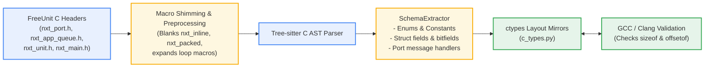

# C Schema & ABI Mirroring

To ensure that `freeunit-model` accurately reflects the exact memory behavior of the production C codebase, it includes a bit-accurate structural extractor and `ctypes` memory layout mirror.

---

## Architecture of the AST Extractor

The extractor (`src/unit_model/ast_extractor.py`) parses FreeUnit C source files using `tree-sitter-c`:



---

## Bit-Accurate Struct Layouts

All data structures exchanged between the router and workers are modeled with byte-level fidelity matching the Linux x86_64 System V ABI.

### 1. `nxt_port_msg_t` (Port Message Header)
Size: 16 bytes. Alignment: 4 bytes.

| Offset | Field | Type | Size | Notes |
|---|---|---|---|---|
| `+0x00` | `stream` | `uint32_t` | 4B | Unique request stream identifier |
| `+0x04` | `pid` | `int32_t` | 4B | Process ID of sender |
| `+0x08` | `reply_port` | `uint16_t` | 2B | Return port ID |
| `+0x0A` | `type` | `uint8_t` | 1B | Message type (`REQ_HEADERS`, `DATA`, `ACK`, etc.) |
| `+0x0B` | `last` | `uint8_t` | 1B | Flag: 1 if final frame of stream |
| `+0x0C` | `mmap` | `uint8_t` | 1B | Flag: 1 if payload references shared memory |
| `+0x0D` | `nf` | `uint8_t` | 1B | Number of attached file descriptors (`SCM_RIGHTS`) |
| `+0x0E` | `mf` | `uint8_t` | 1B | More fragments flag |

### 2. `nxt_app_queue_item_t` (Ring Buffer Item)
Size: 36 bytes. Alignment: 4 bytes.

| Offset | Field | Type | Size | Notes |
|---|---|---|---|---|
| `+0x00` | `size` | `uint8_t` | 1B | Valid payload byte count ($\le 31$) |
| `+0x01` | `data[31]` | `uint8_t[31]` | 31B | Inlined message payload |
| `+0x20` | `tracking` | `uint32_t` | 4B | Monotonic tracking index for cycle detection |

### 3. `nxt_unit_request_t` (Worker Request Header)
Size: 96 bytes. Alignment: 8 bytes.

Contains packed length bytes, string offset pointers (`nxt_unit_sptr_t`), query/path indices, and HTTP field array pointers.

---

## Layout Validation

To verify that the Python `ctypes` mirror never diverges from the compiled C representation, run:

```bash
uv run --with tree-sitter --with tree-sitter-c unit-model schema
```

This compiles an ephemeral C test harness querying `sizeof()` and `offsetof()` for every struct field and asserts bit-for-bit equality against `c_types.py`.
