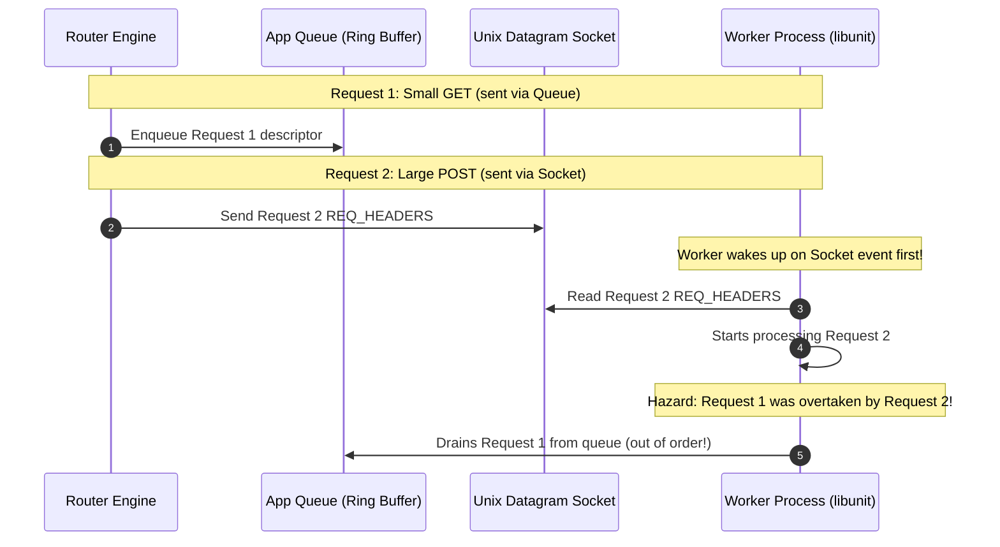
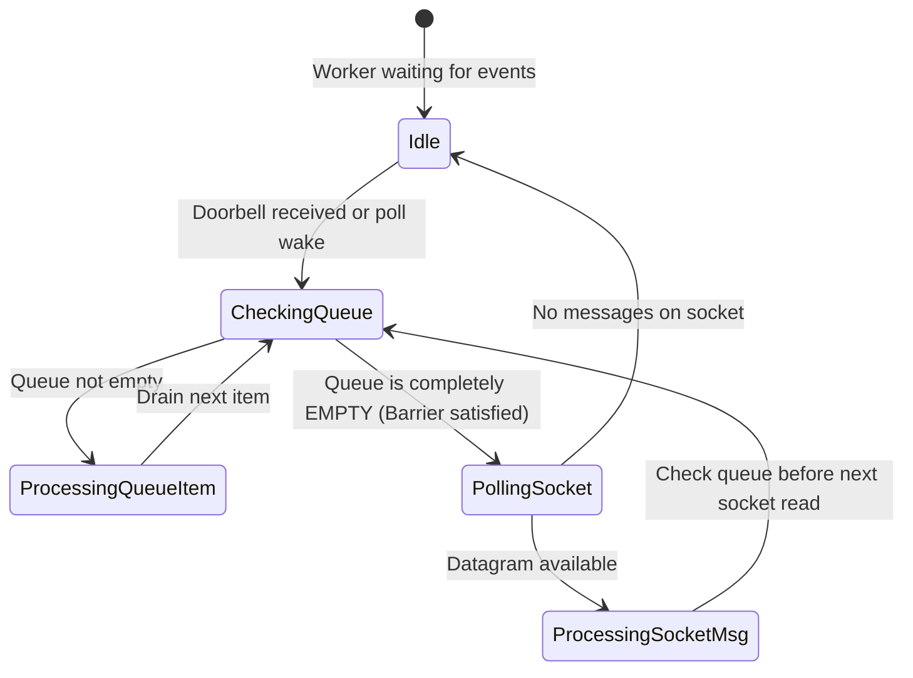

# Dual-Channel IPC & Invariants

A critical design characteristic of FreeUnit is its dual-channel IPC architecture between the router process and application workers. This document explains the operational dynamics, historical race conditions, and how `freeunit-model` formally verifies message ordering.

---

## Channels Comparison

| Property | Application Queue (`nxt_app_queue_t`) | Unix Datagram Socket (`nxt_port_socket.c`) |
|---|---|---|
| **Underlying Mechanism** | Lockless circular ring buffer in shared memory | `AF_UNIX` datagram socket pair (`SOCK_DGRAM`) |
| **Descriptor Payload** | Maximum 31 bytes (`size` + `data[31]` + `tracking`) | Unbounded socket datagrams + ancillary `SCM_RIGHTS` |
| **Signaling** | Atomic `notified` flag / Doorbell (`DOORDEL`) | Socket readiness wake-up via `epoll` / `poll` |
| **Typical Use** | Fast-path request dispatch (GET/HEAD without large bodies) | Large headers, multi-chunk bodies, control messages (`SHM_ACK`) |

---

## Historical Race Condition: Message Inversion (#573, #597)

Prior to FreeUnit commits `39700f29` and `66048b7b`, a subtle timing hazard existed when requests transitioned between the shared-memory queue and the Unix datagram socket:

### The Failure Mode
If the worker process checked the socket first while descriptors were still pending in the queue ring buffer, a later datagram message could overtake an earlier queued message. In HTTP streaming or WebSocket sessions, this resulted in response bodies being parsed as headers, triggering spurious `HTTP 503 Service Unavailable` errors.

---

## The Solution: Queue Drain Barrier & Request FSM

To guarantee strict First-In, First-Out (FIFO) ordering across both transport channels, FreeUnit introduced:
1. **Explicit Queue State Machine**: Each request transitions strictly across `UNQUEUED` $\to$ `QUEUED` $\to$ `SOCKET`.
2. **Queue Drain Barrier**: Before reading any new datagram from the Unix socket, workers must unconditionally drain the shared-memory ring buffer to exhaustion.

---

## Verification in `freeunit-model`

In `freeunit-model`, this ordering contract is proven by **`AdversarialInterleaver`** (`src/unit_model/analyzer/interleaver.py`) and validated by `tests/test_dual_channel.py`.

The test simulates:
- 30 rapid sequential requests dispatched across both queue and socket channels.
- Randomized arrival delays injected into the socket channel.
- The invariant checker confirms that response stream IDs arrive at the client in strict monotonic sequence, proving that the queue drain barrier eliminates the dual-channel inversion hazard.
