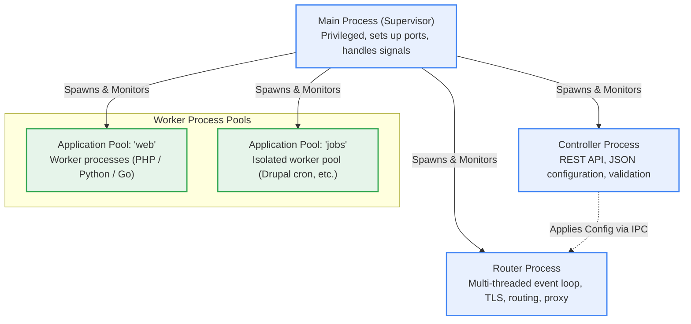
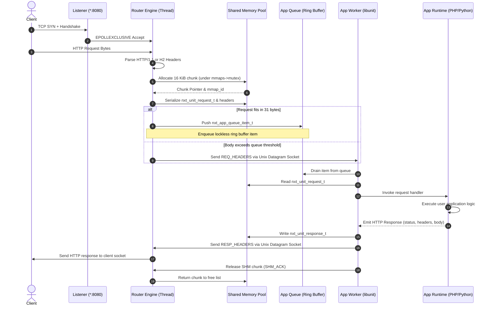

# FreeUnit Subsystem Architecture & Lifecycle

This document provides a detailed breakdown of FreeUnit's runtime architecture, data plane mechanics, and how each subsystem is modeled in `freeunit-model`.

---

## Process Topology

FreeUnit operates as a process hierarchy designed for fault tolerance and zero-downtime reconfiguration:

---

## Request Lifecycle Sequence

When an external client initiates an HTTP request, the data travels through the following sequence across threads and processes:

---

## Subsystem Details

### 1. Listener (`src/unit_model/engine/listener.py`)
- FreeUnit uses `EPOLLEXCLUSIVE` on Linux to avoid the thundering herd problem when multiple router threads wait on the listening socket.
- Connections are tracked via explicit state machines (`INIT`, `ACCEPTED`, `HANDSHAKE`, `READING`, `PROCESSING`, `SENDING`, `KEEPALIVE_IDLE`, `CLOSING`, `CLOSED`).
- Idle connections in keep-alive state are managed with connection-scoped tasks (`c->task`) and deferred release timers (`r->timer`), ensuring no dangling pointer dereferences occur when an application timeout fires.

### 2. Router Engine (`src/unit_model/engine/router.py`)
- Operates $N$ event engines (`nxt_event_engine_t`), each running a non-blocking event loop.
- Manages an RPC stream hash table (`RpcStream`), tracking in-flight requests from creation until client response completion.
- Dispatches requests to workers using a dual-channel strategy:
  - If the request descriptor fits within the 31-byte inline payload of an `nxt_app_queue_item_t`, it is placed directly onto the lockless ring buffer.
  - If the request requires socket datagram transport, it falls back to Unix domain sockets.

### 3. Shared Memory Pool (`src/unit_model/engine/shm_pool.py`)
- Request and response bodies are transferred via pre-allocated shared memory segments partitioned into 16 KiB chunks.
- Allocations are protected by `mmaps->mutex`.
- Implements Out-Of-Shared-Memory (OOSM) backpressure: when free chunks are exhausted, workers and router engines enter probe-mode or defer writes until `SHM_ACK` messages return freed chunks.

### 4. App Worker Runtime (`src/unit_model/engine/worker.py`)
- Built on `libunit` C client library.
- Workers poll both the private socket pair and the shared-memory queue ring buffer.
- To prevent race conditions, workers enforce a strict **queue drain barrier**: they must completely drain any pending descriptors in the shared-memory ring buffer before falling back to socket datagram processing.
