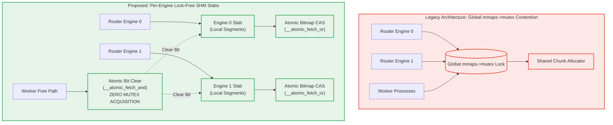

# Lock-Free Per-Engine Shared Memory Slabs

In FreeUnit, shared memory buffer allocation currently funnels through a global mutex in `src/nxt_port_memory.c` (`mmaps->mutex`). On high-concurrency multicore servers (32–64+ cores), this lock becomes a critical scalability bottleneck.

The `src/unit_model/synthesis/` module formalizes and verifies the architectural replacement: **Lock-Free Per-Engine SHM Slabs**.

---

## 1. Architectural Comparison



---

## 2. Key Verified Invariants

1. **Zero Global Mutex Contention**: Slabs allocate locally and free remotely with provably **zero** mutex locks.
2. **Cross-Engine Remote Freeing**: Chunks allocated on Engine $A$ and freed by Engine $B$ or Worker $W$ atomically clear the corresponding bit in Slab $A$'s bitmap using `__atomic_fetch_and(&bitmap[word], ~mask, __ATOMIC_ACQ_REL)`.
3. **Double-Free Immunity**: Attempting to clear an already unset bit raises an immediate error, preventing silent memory corruption.
4. **Conservation & Zero Memory Leaks**: Full conservation of chunks across high-concurrency churn verified under multi-threaded stress testing.

---

## 3. Simulation & Validation API (`LockFreeShmPool`)

```python
from unit_model.synthesis import LockFreeShmPool

pool = LockFreeShmPool(num_engines=4)

# Engine 0 allocates a 16 KiB chunk locally (zero locks)
chunk = pool.alloc(engine_id=0)

# Worker on Engine 2 frees the chunk remotely (zero locks)
pool.free(chunk, calling_engine_or_worker_id=2)

assert pool.verify_invariants() is True
stats = pool.get_stats()
assert stats["global_mutex_locks"] == 0
assert stats["active_chunks"] == 0
```
