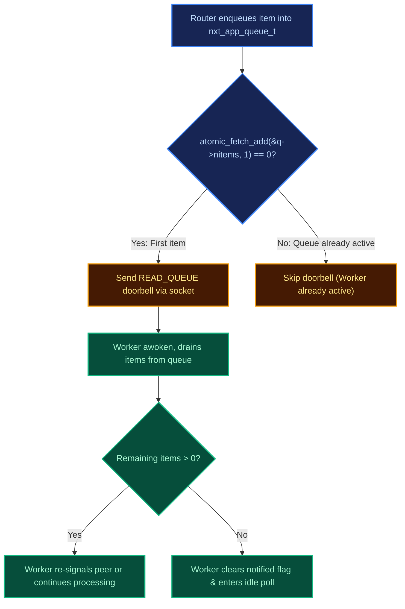
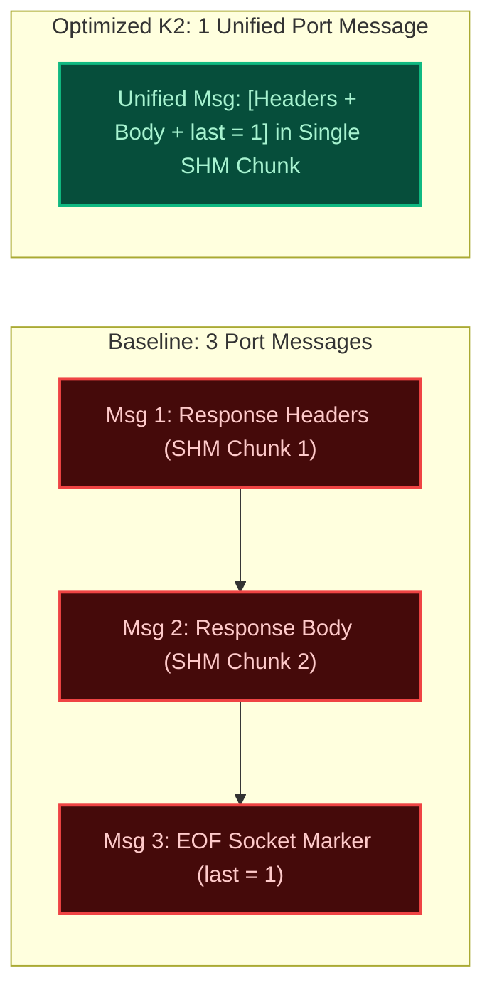
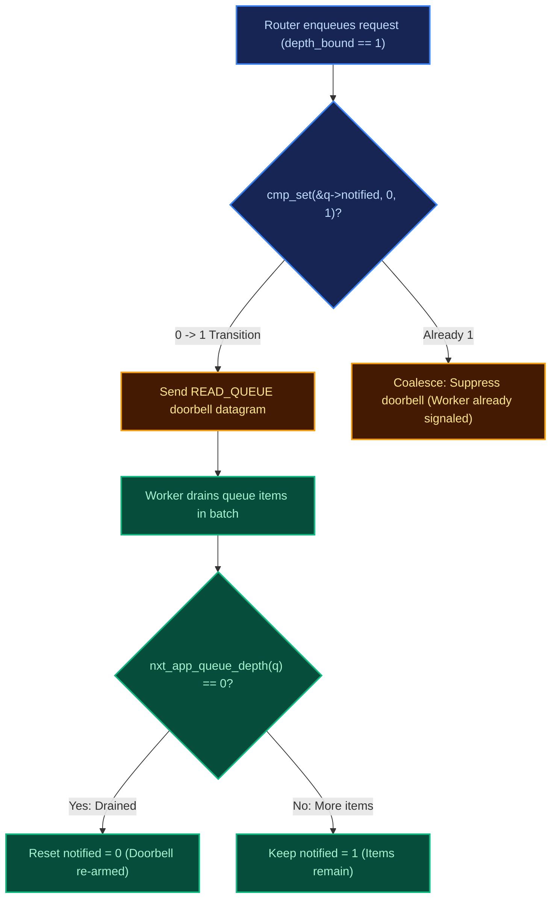

# Optimization Proposals: K1 Doorbell & K2 Response Framing

`freeunit-model` serves as an architectural testbed for prototyping performance improvements before proposing them to the FreeUnit C codebase.

!!! warning "What is in master and what is a proposal"
    Checked against FreeUnit master `42251f7c9e366df31a2e70a5da3679a2fa855b3d`:

    - **In master**: the producer-side doorbell rule of `nxt_app_queue_send_bound()` (`src/nxt_app_queue.h:82-144`): one reader rings on the `0 -> 1` transition of `notified`; more readers ring when the item lands below `depth_bound` (`nxt_app_queue_notify_decision`, `:72-76`; the bound is `processes * threads` or the number of registered readers, `src/nxt_router.c:8725-8746`). The signalfd `EAGAIN` classification (PR 776) is in master.
    - **Proposals, not in master**: the worker-side *baton pass* of K1, and K2 single-buffer response framing (`NXT_PHP_RESPONSE_ROOM` does not exist in master). The sections below describe them as proposals.

---

## K1: Single-Wake Doorbell (Herd Elimination)

### The Problem in Baseline IPC
In the baseline FreeUnit implementation, every enqueue of a request descriptor into the shared-memory ring buffer (`nxt_app_queue_t`) posts a `READ_QUEUE` doorbell datagram to the worker's socket.
- On a burst of 1,000 incoming requests, this triggers **1,000 separate IPC doorbell notifications**, causing severe context switching and CPU thrashing across worker processes.

### The K1 Proposal
Master already coalesces at the producer (see the note above). K1 adds a worker-side baton pass on top of it; the baton pass is **not in master**:
1. When enqueuing, the router performs an atomic test on the `notified` flag:
   $$\text{notify} = (\text{atomic\_fetch\_add}(\&q\to nitems, 1) == 0)$$
2. Only the first enqueuer that transitions the queue from empty to non-empty sends a doorbell.
3. The woken worker drains items and passes the baton: if the queue depth remains $> 1$ after draining an item, the worker re-signals peer workers.

### Benchmark Results
Run `uv run unit-model benchmark-optimizations`:
- **Baseline Doorbell Wakeups**: 1,000 notifications.
- **K1 Optimized Wakeups**: 1 notification.
- **Reduction**: **99.9% fewer IPC context switches** under high-throughput batching!

---

## K2: Single-Buffer Response Framing (proposal, not in master)

### What master does
`libunit` sends one port message per application write (`nxt_unit_response_write_nb`, `src/nxt_unit.c:3849-3936`):
1. The header buffer is at least `NXT_UNIT_RESPONSE_PLAIN_ALLOC` = 1008 bytes (`src/nxt_unit.c:2949-2951`). The first write rides in it as piggyback content when it fits the room left behind the fields; if the buffer is plain-sized (<= 1024 bytes) and the write does not fit, the header goes alone (`:3873-3900`). The message carries no last flag.
2. Every later write is one more `DATA` message: plain memory up to 15 bytes, shared memory when a chunk is free, plain fallback up to 1024 bytes, a wait for `SHM_ACK` above that (`nxt_unit_get_outgoing_buf`, `:5805-5912`).
3. `nxt_unit_request_done()` ends the stream with an empty `DATA` message with the last flag, or sends a never-sent header with the last flag (`:4980-5033`).

So `echo "Hello"` is **two** messages (header + piggyback, then the empty last message), not three, and master does budget piggyback room: whatever is left of the 1008 bytes. A 50 KiB page in 4 KiB flushes is 15 messages.

### The K2 Proposal
K2 would raise the piggyback reserve (`buf_size + reserve`, e.g. 8 KiB) and send the last flag with the header message when the whole body fits:
- Small responses are packed into the same buffer immediately trailing the response headers and complete in **one** message.
- The router parses headers and body content in a single pass.

Open question: a response that completes in its header message bypasses the compressor's streaming path only if the router handles piggyback content through `nxt_http_comp_compress_app_response` as it does today (`src/nxt_router.c:6589-6610`).

### Expected effect (proposal)
- One message instead of two for responses that fit the reserve (`echo "Hello"`: 2 -> 1).
- One shared-memory allocation less per such response. Not measured against master.

---

## Single-Worker Queue Notification Coalescing (Commit `edd1283ca`)

### The Problem with Uncoalesced Single-Worker Signals
In FreeUnit with a single worker process (`depth_bound = 1`), position-based notification checks signaled every request arriving after the queue was drained. On single-worker PHP hello benchmarks, these repeated signals cost approximately **4% CPU**.

### The Solution: 0->1 Flag Coalescing & Drain Re-arming
Commit `edd1283ca` re-introduced coalescing on the `q->notified` flag specifically when `depth_bound == 1`:
1. **Producer Side**: The router signals the application port only on the atomic `0 -> 1` transition of `q->notified`. Subsequent enqueues while `notified == 1` suppress the doorbell.
2. **Consumer Side & Re-arming**: `nxt_app_queue_recv()` re-arms the doorbell by resetting `notified = 0` whenever the queue depth reaches zero (`nxt_app_queue_depth(q) == 0`).
3. **Deadlock Immunity**: If a worker dequeues without reading the doorbell (e.g. already awake from a previous task or crash recovery), the flag is cleared as soon as the queue drains, preventing permanent queue stalls.

---

## Multi-Engine Epoll signalfd Spurious Wakeup Classification (PR 776)

### Multi-Threaded signalfd Race
In multi-threaded FreeUnit router engines, `signalfd` is non-blocking (`O_NONBLOCK`). When a process-directed signal (`SIGCHLD`, `SIGHUP`) arrives:
- Epoll reports the descriptor readable across multiple engine threads.
- Thread 1 wins the race, reads 128 bytes (`struct signalfd_siginfo`), and consumes the signal.
- Thread 2 attempts `read()`, but the kernel signal queue is now empty, returning `n = -1` with `errno = EAGAIN`.

### The Fix (`14c69bbce`)
FreeUnit introduced `nxt_epoll_signalfd_eagain(n, err)` to explicitly classify `(n == -1 && err == NXT_EAGAIN)` as a benign spurious wakeup rather than an error:
- Erroneous reads (e.g. `EINTR` or short reads $< 128$ bytes) still log `nxt_alert()`.
- Spurious `EAGAIN` wakeups return immediately without false-positive alerts, keeping CI and production logs clean.
