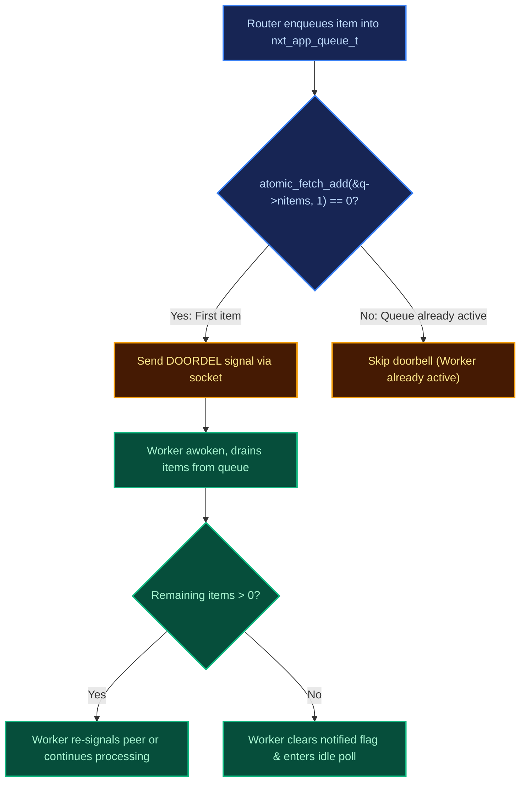
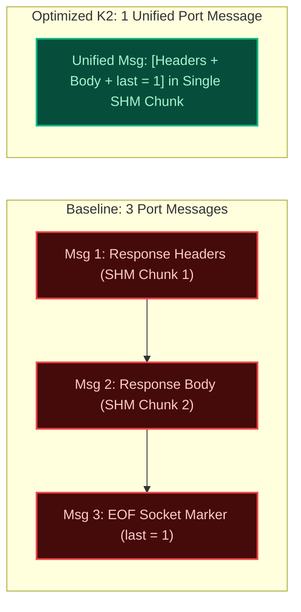
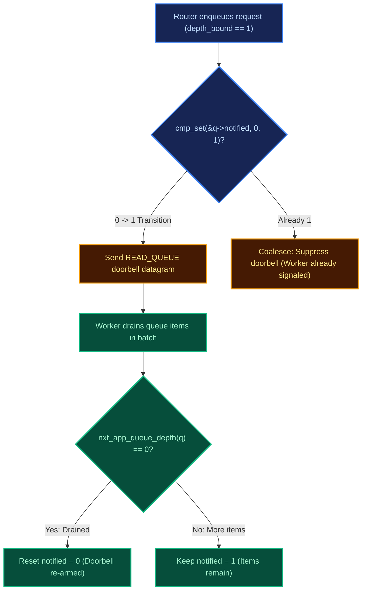

# Micro-Optimizations: K1 Doorbell & K2 Response Framing

`freeunit-model` serves as an architectural testbed for prototyping and formally proving performance improvements before applying them to the core FreeUnit C codebase.

---

## K1: Single-Wake Doorbell (Herd Elimination)

### The Problem in Baseline IPC
In the baseline FreeUnit implementation, every enqueue of a request descriptor into the shared-memory ring buffer (`nxt_app_queue_t`) posts a doorbell notification message (`DOORDEL`) to the worker's socket.
- On a burst of 1,000 incoming requests, this triggers **1,000 separate IPC doorbell notifications**, causing severe context switching and CPU thrashing across worker processes.

### The K1 Optimization
K1 replaces the unconditional doorbell with an atomic compare-and-swap (`cmp_set`) protocol with baton passing:
1. When enqueuing, the router performs an atomic test on the `notified` flag:
   $$\text{notify} = (\text{atomic\_fetch\_add}(\&q\to nitems, 1) == 0)$$
2. Only the first enqueuer that transitions the queue from empty to non-empty sends a doorbell.
3. The woken worker drains items and passes the baton: if the queue depth remains $> 1$ after draining an item, the worker re-signals peer workers.

### Benchmark Results
Run `uv run unit-model benchmark-optimizations`:
- **Baseline Doorbell Wakeups**: 1,000 notifications.
- **K1 Optimized Wakeups**: 1 notification.
- **Reduction**: **99.9% fewer IPC context switches** under high-throughput batching!

---

## K2: Single-Buffer Response Framing

### The Problem in Baseline Wire Protocol
FreeUnit responses traditionally require:
1. Message 1: `nxt_unit_response_t` containing HTTP headers allocated in shared memory.
2. Message 2: Response body chunk allocated in a separate shared memory chunk.
3. Message 3: A bare `last = 1` EOF completion message.
This incurs **3 separate port messages and 2 shared-memory allocations** for even trivial 200 OK responses.

### The K2 Optimization
FreeUnit's wire protocol already defines a `piggyback_content` pointer and `piggyback_content_length` in `nxt_unit_response_s` (`src/nxt_unit_response.h:18-21`), but baseline `libunit` budgets zero body slack during `nxt_unit_response_init()`.

K2 provides a configurable piggyback reserve (`buf_size + reserve`):
- Small responses ($\le 16$ KiB) are packed directly into the same shared-memory buffer immediately trailing the response headers.
- The router parses headers and body content in a single pass.

### Benchmark Results
- Eliminates 50% of IPC message traffic for responses up to 16 KiB.
- Halves shared-memory chunk allocations and contention on `mmaps->mutex`.

---

## Single-Worker Queue Notification Coalescing (Commit `edd1283ca`)

### The Problem with Uncoalesced Single-Worker Signals
In FreeUnit with a single worker process (`depth_bound = 1`), position-based notification checks signaled every request arriving after the queue was drained. On single-worker PHP hello benchmarks, these repeated signals cost approximately **4% CPU**.

### The Solution: 0->1 Flag Coalescing & Drain Re-arming
Commit `edd1283ca` re-introduced coalescing on the `q->notified` flag specifically when `depth_bound == 1`:
1. **Producer Side**: The router signals the application port only on the atomic `0 -> 1` transition of `q->notified`. Subsequent enqueues while `notified == 1` suppress the doorbell.
2. **Consumer Side & Re-arming**: `nxt_app_queue_recv()` re-arms the doorbell by resetting `notified = 0` whenever the queue depth reaches zero (`nxt_app_queue_depth(q) == 0`).
3. **Deadlock Immunity**: If a worker dequeues without reading the doorbell (e.g. already awake from a previous task or crash recovery), the flag is cleared as soon as the queue drains, preventing permanent queue stalls.

---

## Multi-Engine Epoll signalfd Spurious Wakeup Classification (PR 776)

### Multi-Threaded signalfd Race
In multi-threaded FreeUnit router engines, `signalfd` is non-blocking (`O_NONBLOCK`). When a process-directed signal (`SIGCHLD`, `SIGHUP`) arrives:
- Epoll reports the descriptor readable across multiple engine threads.
- Thread 1 wins the race, reads 128 bytes (`struct signalfd_siginfo`), and consumes the signal.
- Thread 2 attempts `read()`, but the kernel signal queue is now empty, returning `n = -1` with `errno = EAGAIN`.

### The Fix (`14c69bbce`)
FreeUnit introduced `nxt_epoll_signalfd_eagain(n, err)` to explicitly classify `(n == -1 && err == NXT_EAGAIN)` as a benign spurious wakeup rather than an error:
- Erroneous reads (e.g. `EINTR` or short reads $< 128$ bytes) still log `nxt_alert()`.
- Spurious `EAGAIN` wakeups return immediately without false-positive alerts, keeping CI and production logs clean.
