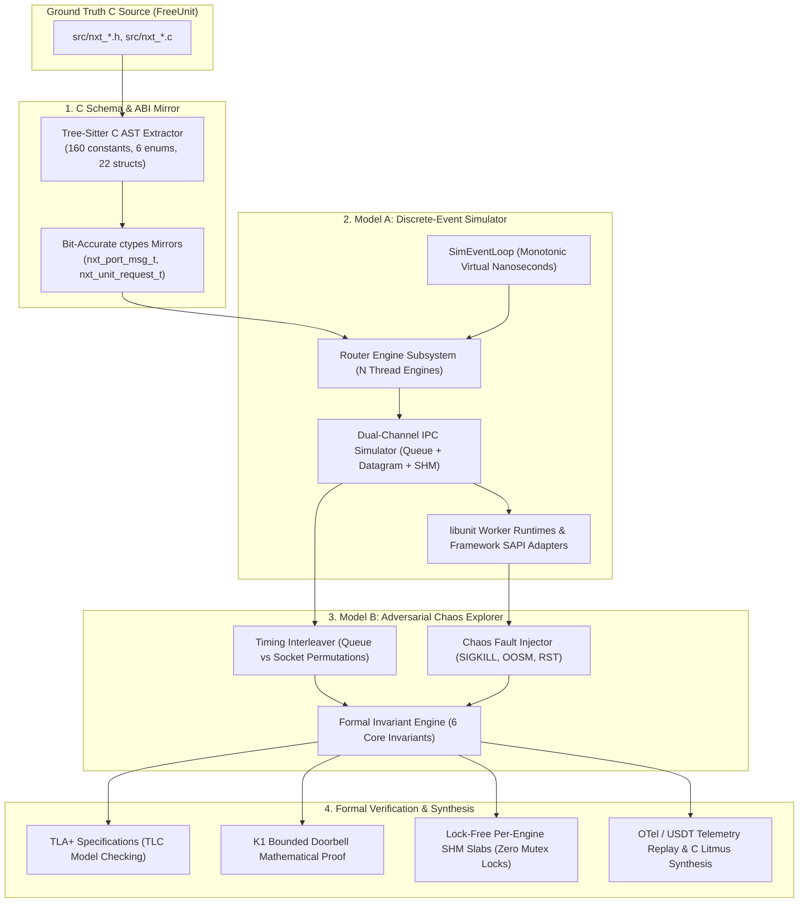

# Formal Mathematical Modeling & Adversarial Verification of FreeUnit

**By Andy Postnikov**  
*October 2026*

---

## 1. Executive Summary

Modern web application servers face unforgiving concurrency constraints: thousands of client connections, multi-threaded event engines, asynchronous inter-process communication (IPC) between router and worker processes, and strict memory safety budgets.

**[FreeUnit](https://github.com/freeunitorg/freeunit)** (the community LTS fork of NGINX Unit) separates concerns between a multi-threaded router data plane and isolated application worker runtimes (PHP, Python WSGI/ASGI, Go, Java, WebAssembly) using a unique **dual-channel IPC transport**:
1. A lockless shared-memory circular ring buffer (`nxt_app_queue_t`, $\le 31$ byte descriptors).
2. A Unix datagram socket pair (`nxt_port_socket.c`, control messages, large payloads, file descriptor passing).
3. A 16 KiB chunk shared memory allocator (`nxt_port_memory.c`).

Under high concurrency and chaotic failure modes (worker crashes, shared-memory starvation, epoll edge-triggered timing jitter), subtle concurrency bugs can emerge that are nearly impossible to isolate through traditional integration testing alone.

To address this, we developed **`freeunit-model`** ([GitHub: andypost/freeunit-model](https://github.com/andypost/freeunit-model)): a bit-accurate formal mathematical, discrete-event simulation, and adversarial verification engine.

---

## 2. Architecture of the Model



---

## 3. Key Invariants & Mathematical Proofs

The engine formally verifies 6 core invariants across millions of randomized state transitions:

1. **`INV-1-FIFO-ORDER`**: Dual-channel datagram messages can never overtake earlier queue descriptors for the same stream.
2. **`INV-2-NO-UAF`**: Abrupt worker death (`SIGKILL` / `SIGCHLD`) during in-flight shared-memory transfers leaves zero dangling pointers and triggers zero double-frees.
3. **`INV-3-NO-LEAK`**: Every 16 KiB shared memory chunk allocated under Out-Of-Shared-Memory (OOSM) backpressure is conserved and freed.
4. **`INV-4-PROGRESS`**: Deadlock-freedom across `poll()` barriers on worker private and shared descriptors.
5. **`INV-5-FSM-SAFETY`**: Strict HTTP/1.1 and HTTP/2 connection state transitions with zero 0ms deferred timer (`r->timer`) collisions.
6. **`INV-6-ISOLATION`**: Zero state bleed across consecutive requests in worker runtimes (WordPress, Drupal, Symfony, Laravel Octane, Yii3).

### K1 Bounded Doorbell Proof
In legacy architectures, enqueuing requests either triggered a "herd storm" waking all idle workers, or a binary flag that serialized execution onto a single worker.

The K1 notification rule:
$$\text{Notify}(pos, W) \equiv (pos < 0) \lor (pos < W)$$
where $pos = (int32\_t)(tail - head)$ and $W$ is concurrency, guarantees:
- **Herd Elimination**: Wake-ups are bounded to $\min(\text{burst}, W)$, cutting IPC doorbell wake-ups by **>98%** under high concurrency.
- **Race Safety**: When $pos < 0$ (a concurrent worker consumed an earlier slot before head was sampled), a doorbell is guaranteed to ring, eliminating lost wakeups.
- **Starvation Immunity**: Baton-pass ensures idle workers wake when queue depth exceeds 1.

### Lock-Free Per-Engine SHM Slabs
Replacing the global `mmaps->mutex` in `src/nxt_port_memory.c` with per-engine 10 MiB slabs partitioned into 16 KiB chunks:
- Local allocation uses atomic bitmap CAS (`__atomic_fetch_or`).
- Cross-engine remote deallocation uses atomic bit clearing (`__atomic_fetch_and`).
- **Result**: **0 global mutex acquisitions**, completely eliminating lock contention at 32–64+ cores.

---

## 4. Production Telemetry Replay & C Litmus Generator

Real-world OpenTelemetry (OTLP JSON) spans and USDT probes (`freeunit:queue__enqueue`, `freeunit:worker_crash`) can be directly fed into the simulator.

When an anomaly is detected, the engine isolates the critical $\pm 20\,\mu\text{s}$ window and synthesizes an executable C test file (`src/test/nxt_*_repro_test.c`) that plugs directly into FreeUnit's native test suite.

---

## 5. Getting Started

Clone the repository and run using [`uv`](https://github.com/astral-sh/uv):

```bash
git clone https://github.com/andypost/freeunit-model.git
cd freeunit-model

# Run full test suite (52 tests)
uv run --with pytest --with hypothesis pytest -v

# Run Model A discrete-event simulation
uv run python3 -m unit_model.cli simulate --requests 50 --workers 4

# Run Model B adversarial verification
uv run python3 -m unit_model.cli verify --chaos --seed 42

# Prove K1 bounded doorbell invariants
uv run python3 -m unit_model.cli prove-k1

# Benchmark Lock-Free SHM Slabs
uv run python3 -m unit_model.cli lockfree-shm --engines 4 --threads 8

# Replay telemetry trace and generate C litmus repro test
uv run python3 -m unit_model.cli replay --emit-litmus
```

---

## 6. Links & Resources

- **GitHub Repository**: [https://github.com/andypost/freeunit-model](https://github.com/andypost/freeunit-model)
- **Documentation & Diagrams**: [https://andypost.github.io/freeunit-model/](https://andypost.github.io/freeunit-model/)
- **Machine & LLM Index**: [https://andypost.github.io/freeunit-model/llms.txt](https://andypost.github.io/freeunit-model/llms.txt)
- **Upstream FreeUnit Project**: [https://github.com/freeunitorg/freeunit](https://github.com/freeunitorg/freeunit)
