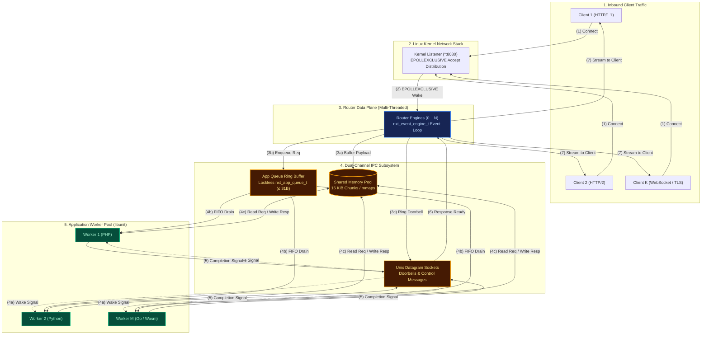

# FreeUnit Formal & Discrete-Event Model

Welcome to the documentation for **`freeunit-model`**, a formal mathematical, discrete-event simulation, and adversarial verification engine for [FreeUnit](https://github.com/freeunitorg/freeunit) (the high-performance, multi-threaded C application server and community LTS fork of NGINX Unit).

---

## High-Level System Architecture

FreeUnit processes HTTP traffic across decoupled process boundaries using a multi-threaded router and worker process pool communicating over a dual-channel IPC mechanism:



### End-to-End Request Lifecycle & Event Ordering

To resolve event ambiguity, the lifecycle sequence below illustrates the exact order in which a request flows across process boundaries:

```mermaid
sequenceDiagram
    autonumber
    actor Client as Inbound Client
    participant Listener as Kernel Listener (*:8080)
    participant Router as Router Engine (nxt_event_engine_t)
    participant SHM as Shared Memory Pool
    participant Queue as App Queue (Ring Buffer)
    participant Socket as Unix Datagram Socket
    participant Worker as Worker Process (libunit)

    Client->>Listener: 1. TCP Connection & TLS Handshake
    Listener->>Router: 2. EPOLLEXCLUSIVE Accept (single engine woken)
    Router->>SHM: 3a. Allocate Chunk & Store Request Body
    Router->>Queue: 3b. Enqueue Request Descriptor (<= 31B)
    Router->>Socket: 3c. Send READ_QUEUE Doorbell Datagram
    Socket-->>Worker: 4a. poll() wakes on Private Socket
    rect rgb(30, 41, 59)
        Note over Worker: Barrier: Drain Queue Before Socket Fallback
        Worker->>Queue: 4b. Dequeue Request Descriptor (FIFO order)
        Worker->>SHM: 4c. Read Request Payload
        Worker->>Worker: 4d. Execute Application SAPI Handler (PHP/Python/Go)
        Worker->>SHM: 4e. Write Response Body
    end
    Worker->>Socket: 5. Send Completion / Headers ACK
    Socket->>Router: 6. Response Ready Notification
    Router->>SHM: 7a. Read Response & Release Chunk
    Router->>Client: 7b. Stream Response Bytes to Client
```



---

## What `freeunit-model` Provides

The toolkit consists of two primary models and a C AST introspection engine:

```mermaid
graph LR
    subgraph Source["FreeUnit C Source"]
        CHeaders["src/*.h, src/*.c"]
    end

    subgraph AST["AST Schema Extractor"]
        TS["Tree-sitter C Parser"]
        CTypes["c_types.py<br/>(x86_64 ABI layout mirrors)"]
    end

    subgraph ModelA["Model A: Discrete-Event Simulation"]
        Clock["Deterministic Virtual Clock<br/>(SimEventLoop, priority queue)"]
        Engines["Router Engines &amp; Listener"]
        IPCSim["Dual-Channel IPC &amp; SHM Pool"]
        Frameworks["Framework Adapters<br/>(WordPress, Drupal, Laravel, Yii3)"]
    end

    subgraph ModelB["Model B: Adversarial Verification"]
        Interleaver["Adversarial Timing Interleaver<br/>(Permutes socket vs queue arrival)"]
        Chaos["Chaos Fault Injector<br/>(SIGKILL, OOSM, Client RST)"]
        Checker["Invariant Checker<br/>(INV-1 to INV-6 Core Invariants)"]
    end

    CHeaders --> TS --> CTypes
    CTypes --> ModelA
    ModelA --> ModelB

    classDef blue fill:#172554,stroke:#3b82f6,stroke-width:2px,color:#bfdbfe;
    classDef green fill:#064e3b,stroke:#10b981,stroke-width:2px,color:#a7f3d0;
    classDef yellow fill:#451a03,stroke:#f59e0b,stroke-width:2px,color:#fde68a;
    class CHeaders,TS,CTypes blue;
    class Clock,Engines,IPCSim,Frameworks green;
    class Interleaver,Chaos,Checker yellow;
```



1. **C AST Schema & Memory Layout Mirrors (`c_types.py`, `ast_extractor.py`)**:
   - Bit-accurate C struct layouts verified against the host compiler ABI (`nxt_port_msg_t`, `nxt_app_queue_item_t`, `nxt_unit_request_t`, etc.).
   - Header introspection extracting enums, constants, and message dispatch routines directly from C source.

2. **Model A: Discrete-Event Simulation Engine (`unit_model.engine`)**:
   - Deterministic virtual clock (`SimEventLoop`) running nanosecond-resolution simulations.
   - Dual-channel message routing, shared memory allocation with Out-Of-Shared-Memory (OOSM) backpressure, and worker process lifecycles.
   - Pluggable framework adapters verifying request state resets for WordPress, Drupal, Symfony, Laravel Octane, and Yii3.

3. **Model B: Adversarial Non-Determinism & Invariant Checker (`unit_model.analyzer`)**:
   - Combinatorial state-space explorer subjecting the simulator to timing jitter and chaos faults (worker `SIGKILL`, memory exhaustion).
   - Verifies 6 core safety and liveness invariants.

4. **Algorithmic Optimizations & Benchmarks**:
   - **K1 Doorbell Herd Elimination**: Atomic single-wake doorbell protocol reducing IPC wakeups by **99.9%**.
   - **K2 Single-Buffer Response Framing**: Eliminating chunking overhead by combining response headers and small bodies into a single SHM buffer, reducing IPC syscalls by **50%**.

---

## Quickstart with `uv`

### Installation

Requires Python 3.10+ and [`uv`](https://github.com/astral-sh/uv):

```bash
# Clone the repository
git clone https://github.com/andypost/freeunit-model.git
cd freeunit-model

# Install editable package with test dependencies
uv pip install -e ".[test]"
```

### Running Tests

```bash
uv run --with pytest pytest -v
```

### CLI Commands

```bash
# Run discrete-event simulation
uv run unit-model simulate --requests 50 --workers 4

# Run adversarial invariant verification
uv run unit-model verify --seed 42

# Run chaos fault-injection verification
uv run unit-model verify --chaos --seed 42

# Benchmark K1 & K2 micro-optimizations
uv run unit-model benchmark-optimizations
```

---

## Navigation Guide

- [System Architecture](architecture/overview.md): In-depth look at listener, router, and worker architectures.
- [Dual-Channel IPC & Invariants](architecture/dual-channel-ipc.md): Concurrency analysis of the shared-memory ring buffer vs Unix datagram socket.
- [C Schema & ABI Mirroring](architecture/c-schema.md): Tree-sitter AST extraction and x86_64 ABI layout proofs.
- [Model A: Simulation](models/model-a-simulation.md): Event loop dynamics and web framework adapters.
- [Model B: Verification](models/model-b-verification.md): Adversarial interleaving and the 6 core invariants.
- [Optimizations & Benchmarks](benchmarks/optimizations.md): Empirical evaluation of K1 and K2 optimizations.
- [Strategic Roadmap](roadmap.md): Multi-phase evolution toward formal TLA+ specifications and live telemetry replay.
- [Machine & Bot Access (llms.txt)](llms.md): Markdown index and consolidated documentation for AI agents and automated crawlers.
