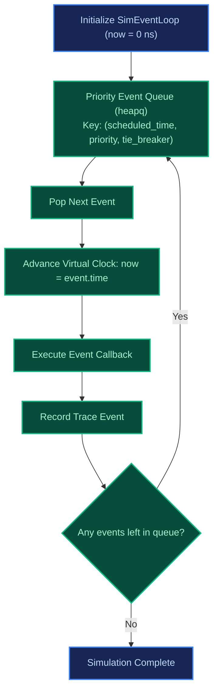
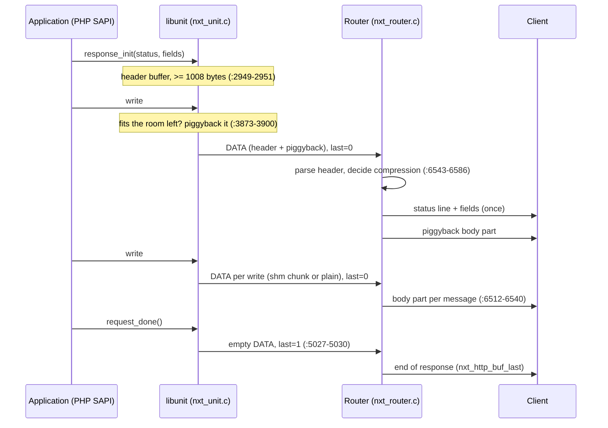
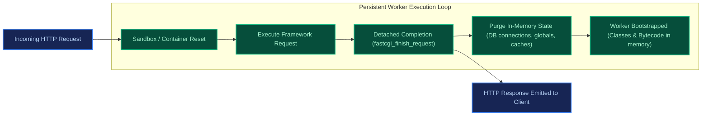

# Model A - Discrete-Event Behavioral Simulation

Model A provides an executable, discrete-event simulation of FreeUnit's data plane, modeling asynchronous I/O, IPC transfer latencies, process scheduling, and web framework lifecycle execution.

---

## The Simulation Core (`SimEventLoop`)

The discrete-event engine (`src/unit_model/engine/event_loop.py`) operates a deterministic virtual clock:

### Event Priority Hierarchy
Events scheduled for the exact same nanosecond timestamp are processed strictly according to priority (`EventPriority` in `event_loop.py`):
1. `HIGH` (0): Signal handling (`SIGKILL`), fault injection, immediate CAS completion.
2. `NORMAL` (1): I/O readiness, socket datagram delivery, queue enqueue/dequeue, memory operations.
3. `TIMER` (2): Epoll timeouts, application request deadlines.
4. `DEFERRED` (3): Deferred connection cleanup timers (0 ms `r->timer` release).

The listener accepts connections round-robin across engines as a stand-in for the kernel's `EPOLLEXCLUSIVE` wake-up of a single engine (`nxt_epoll_enable_accept`, `src/nxt_epoll_engine.c:645-659`). Master speaks HTTP/1.x only; HTTP/2 is in open FreeUnit pull requests (#463, #471, #479, #483), not in master, and the `protocols/h2.py` module describes those proposals.

---

## The Response Path (libunit to router)

Checked against FreeUnit master `42251f7c9e366df31a2e70a5da3679a2fa855b3d`. The worker (`engine/worker.py`) sends the response **one port message per application write**, exactly as `libunit` does; it never builds the whole response first.

| Step | Master | Model |
|---|---|---|
| Header buffer | `nxt_unit_response_init()` sizes it from the fields and raises it to `NXT_UNIT_RESPONSE_PLAIN_ALLOC` = 1008 bytes (`src/nxt_unit.c:2949-2951`) | `AppWorker.header_buf_size()` |
| First write | `nxt_unit_response_write_nb()`: if the header buffer is plain-sized (<= 1024) and the write exceeds the room left, the header goes alone; otherwise the part that fits rides as piggyback content; `nxt_unit_response_send()` sends it without the last flag (`src/nxt_unit.c:3873-3900`, `3249-3287`) | `_continue_response()` / `_response_send()` |
| Later writes | one buffer per write, up to `PORT_MMAP_DATA_SIZE` each (`src/nxt_unit.c:3904-3933`) | `_mmap_buf_send()` |
| Memory choice | `nxt_unit_get_outgoing_buf()` (`src/nxt_unit.c:5805-5912`): <= 15 bytes (`NXT_UNIT_QUEUE_PLAIN_SIZE`) or any plain-sized buffer on the socket is plain memory; <= 1024 bytes probes shared memory and falls back to plain; > 1024 bytes needs a chunk | `_get_outgoing_buf()` |
| Out of shared memory | a buffer that may be plain never waits; a larger one sends `OOSM` and blocks in `recv` for `SHM_ACK` (`nxt_unit_mmap_get`, `src/nxt_unit.c:5296-5346`; `nxt_unit_wait_shm_ack`, `:5402-5470`). The router acks at once if it already sees a free chunk (`nxt_router_oosm_handler`, `src/nxt_router.c:9679-9755`) and otherwise when it frees a chunk (`nxt_port_mmap_buf_completion`, `src/nxt_port_memory.c:240-252`) | `SharedMemoryPool.wait_shm_ack()`, `router_oosm_handler()`, `_on_shm_ack()` |
| End of response | `nxt_unit_request_done()`: a header never sent goes now with `last=1` (`nxt_unit_buf_send_done`); otherwise an empty `DATA` message with `last=1` (`src/nxt_unit.c:4980-5033`) | `_request_done()` |
| Channel | `nxt_unit_req_send()`: a message of <= 31 bytes (16-byte header + 12-byte mmap record, or <= 15 bytes of plain data) goes through the port queue when the request is queued or the last shm allocation worked; else the socket (`src/nxt_unit.c:8662-8716`) | `_req_send()`, `ReqQueueState` |
| Chunk release | the worker frees the request chunks when it releases the request (`src/nxt_unit.c:2621-2627`) and the unused tail of a response buffer after the send (`:3661-3680`); the router frees a header chunk with no piggyback right after the parse (`src/nxt_router.c:6543-6555`) and body chunks when the client write completes (`nxt_port_mmap_buf_completion`) | `_request_info_release()`, `Router.on_worker_response_msg()` |

Example: `echo "Hello"` is two messages (header with piggyback, then the empty last message). A 50 KiB page written in 4 KiB flushes is 15 messages (header alone, 13 writes, empty last). `unit-model benchmark-optimizations` prints both.

**Simplifications.** One `SharedMemoryPool` stands for both directions; master has one segment set per process pair and direction (`lib->outgoing`, `process->incoming`). The `NXT_UNIT_SHM_RETRY` back-off (60 s) never expires on the simulated clock. The queue drain wait before a request moves to the socket (`nxt_unit_req_queue_drain`) always succeeds because the simulated router takes queue items as they come.

---

## Web Framework Lifecycle Adapters

!!! note "The response sizes and write patterns are assumptions"
    `engine/frameworks/profile.py` gives each adapter a log-normal body size distribution and a write pattern. These numbers are **not measured** and are **not properties of FreeUnit**; they are inputs that make the response path above exercise realistic cases. Each adapter's docstring names the assumption.

| Adapter | Body size (median, range) | Writes | Assumption |
|---|---|---|---|
| WordPress | 50 KiB (30-80 KiB) HTML | ~4 KiB flushes | php.ini-production `output_buffering=4096`; default theme front page |
| Drupal | 35 KiB (20-60 KiB) HTML | ~4 KiB flushes | Symfony `Response::send()` echoes once; output buffering splits it |
| Symfony | 3 KiB (1-8 KiB) JSON | 1 | `Response::send()` echoes once, then `flush()` |
| Laravel Octane | 1.5 KiB (0.5-4 KiB) JSON | 1 | one write; bodies under ~900 bytes ride with the header |
| Yii3 | 16 KiB (8-40 KiB) HTML | header flushed first, then 1 write | `yii-runner-http` `SapiEmitter` flushes headers before the body |

FreeUnit supports both Classic (fork-per-request / shared-nothing) and Worker (persistent in-memory application worker) execution modes. Model A implements dedicated state-reset adapters for the major web frameworks:

### Supported Framework Adapters

1. **WordPress (`WordPressAdapter`)**:
   - Manages global mutations (`$wpdb`, `$wp_query`, `$current_user`).
   - Simulates `wp-cron.php` (`DISABLE_WP_CRON`) triggered via scheduled internal GET requests.

2. **Drupal (`DrupalAdapter`)**:
   - Simulates `DrupalRuntime` in worker mode.
   - Detached request completion (`unit_finish_request()`), allowing background tasks to proceed without delaying the client HTTP response (solving Issue #321).
   - Resets the dependency injection container and entity manager.

3. **Symfony (`SymfonyAdapter`)**:
   - Models `runtime/unit-symfony` integrating with `ResetInterface`.
   - Clears the entity manager (`$em->clear()`), purges the Monolog buffer, and empties the request stack.

4. **Laravel Octane (`LaravelAdapter`)**:
   - Clones the base sandbox application container (`$app->clone()`).
   - Purges authentication guards, flushes queued cookies, and reconnects dead database pools.
   - Models request limits with randomized jitter (`max_requests` restart).

5. **Yii3 (`Yii3Adapter`)**:
   - Simulates `yiisoft/yii-runner-unit` utilizing `Yiisoft\Di\StateResetter`.
   - Reverts uncommitted database transactions and flushes middleware state.

---

## Scheduled Requests (PR #452)

FreeUnit's internal scheduler executes synthetic HTTP requests against applications without external network traffic:
- Operates under the `DEVNULL` protocol table.
- Bounded concurrency capacity separation ensuring batch cron jobs cannot starve interactive user traffic.
- Monitored by dedicated run deadline timers (`r->timer` isolation).
