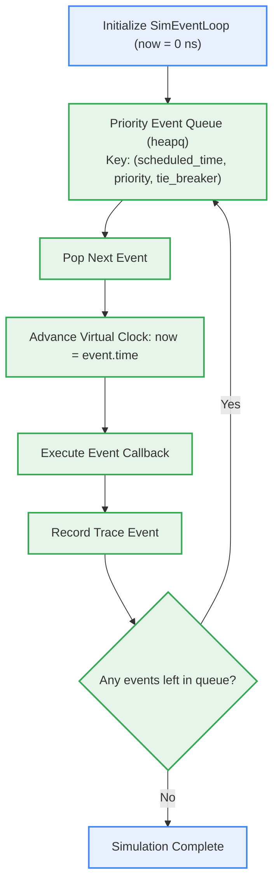
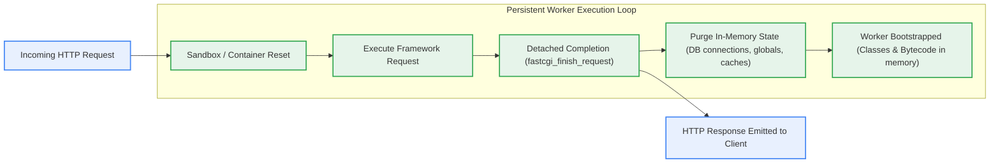

# Model A - Discrete-Event Behavioral Simulation

Model A provides an executable, discrete-event simulation of FreeUnit's data plane, modeling asynchronous I/O, IPC transfer latencies, process scheduling, and web framework lifecycle execution.

---

## The Simulation Core (`SimEventLoop`)

The discrete-event engine (`src/unit_model/engine/event_loop.py`) operates a deterministic virtual clock:

### Event Priority Hierarchy
Events scheduled for the exact same nanosecond timestamp are processed strictly according to priority:
1. `CRITICAL` (Priority 0): Signal handling (`SIGKILL`, `SIGTERM`), fatal process terminations.
2. `HIGH` (Priority 1): Kernel socket accept events (`EPOLLEXCLUSIVE`), socket notifications.
3. `NORMAL` (Priority 2): Application queue enqueue/dequeue, IPC message read/write.
4. `LOW` (Priority 3): Application request execution, CPU-bound framework logic.
5. `DEFERRED` (Priority 4): Deferred connection cleanup timers (0 ms `r->timer` release).

---

## Web Framework Lifecycle Adapters

FreeUnit supports both Classic (fork-per-request / shared-nothing) and Worker (persistent in-memory application worker) execution modes. Model A implements dedicated state-reset adapters for the major web frameworks:

### Supported Framework Adapters

1. **WordPress (`WordPressAdapter`)**:
   - Manages global mutations (`$wpdb`, `$wp_query`, `$current_user`).
   - Simulates `wp-cron.php` (`DISABLE_WP_CRON`) triggered via scheduled internal GET requests.

2. **Drupal (`DrupalAdapter`)**:
   - Simulates `DrupalRuntime` in worker mode.
   - Detached request completion (`unit_finish_request()`), allowing background tasks to proceed without delaying the client HTTP response (solving Issue #321).
   - Resets the dependency injection container and entity manager.

3. **Symfony (`SymfonyAdapter`)**:
   - Models `runtime/unit-symfony` integrating with `ResetInterface`.
   - Clears the entity manager (`$em->clear()`), purges the Monolog buffer, and empties the request stack.

4. **Laravel Octane (`LaravelAdapter`)**:
   - Clones the base sandbox application container (`$app->clone()`).
   - Purges authentication guards, flushes queued cookies, and reconnects dead database pools.
   - Models request limits with randomized jitter (`max_requests` restart).

5. **Yii3 (`Yii3Adapter`)**:
   - Simulates `yiisoft/yii-runner-unit` utilizing `Yiisoft\Di\StateResetter`.
   - Reverts uncommitted database transactions and flushes middleware state.

---

## Scheduled Requests (PR #452)

FreeUnit's internal scheduler executes synthetic HTTP requests against applications without external network traffic:
- Operates under the `DEVNULL` protocol table.
- Bounded concurrency capacity separation ensuring batch cron jobs cannot starve interactive user traffic.
- Monitored by dedicated run deadline timers (`r->timer` isolation).
