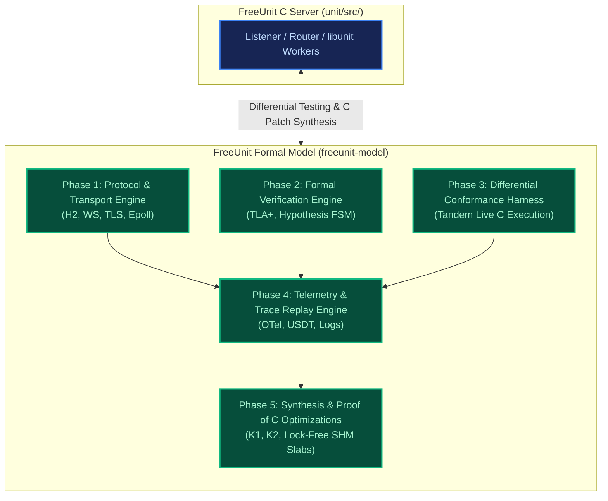
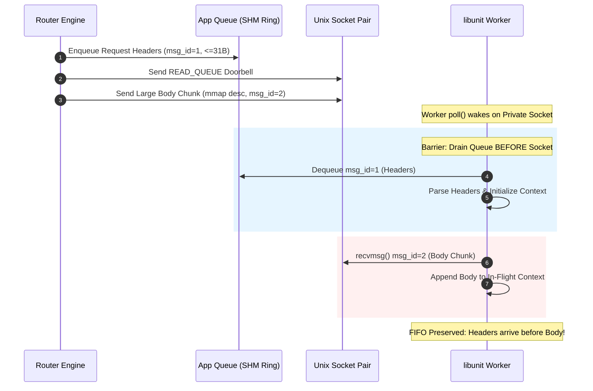
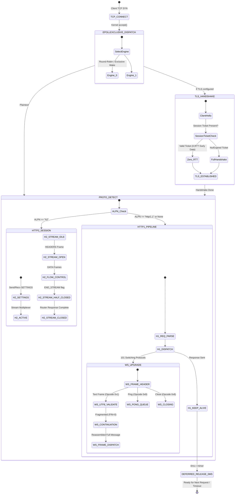
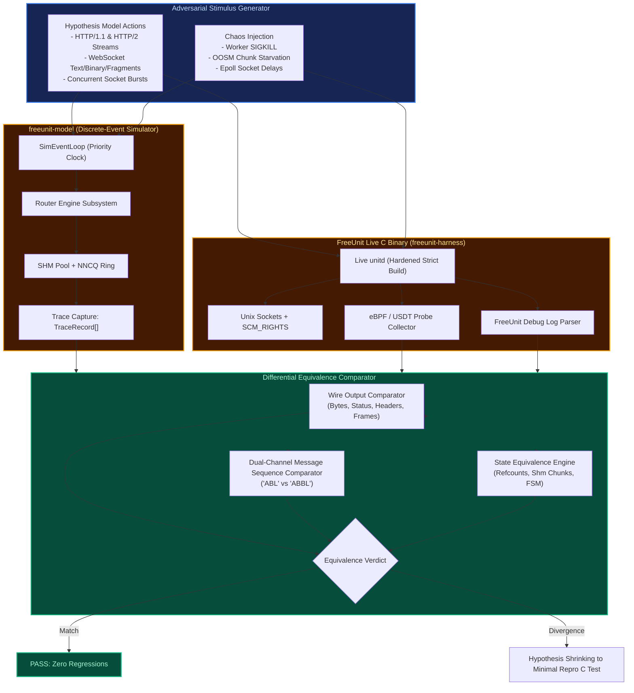
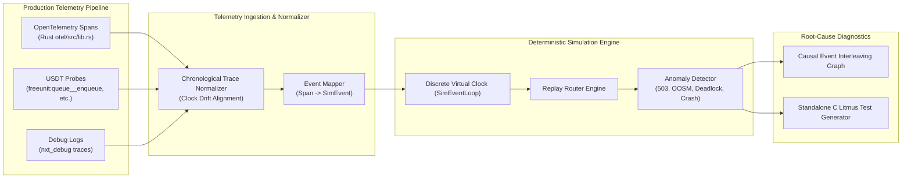
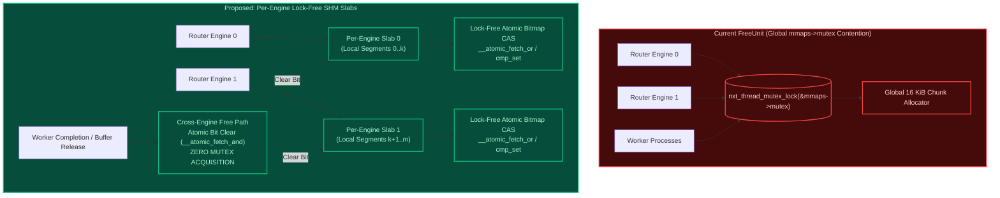

# Strategic Roadmap: FreeUnit Formal Model, Conformance & Synthesis Engine

**Architectural Memory Reference**: `unit/GEMINI.md`  
**C Ground-Truth Target**: `unit/src/`  
**Model Core**: `src/unit_model/`  
**Harness Integration**: `freeunit-harness/tools/model/`  

---

## 1. Executive Summary & Vision

The `freeunit-model` project has transitioned from an initial discrete-event simulation prototype into an architectural pillar for [FreeUnit](https://github.com/freeunitorg/freeunit) (the high-performance, community LTS fork of NGINX Unit). The mission of `freeunit-model` is threefold:

1. **High-Fidelity Behavioral Oracle**: Faithfully simulate the exact protocol, scheduling, and IPC dynamics of FreeUnit—spanning Linux edge-triggered `epoll`, TLS 1.3 session resumption, HTTP/2 multiplexing, WebSocket streams, lockless numeric naive circular queues (NNCQ), and multi-engine shared-memory allocation.
2. **Formal Verification & Chaos Discovery Platform**: Prove core safety and liveness invariants (FIFO stream ordering, leak freedom, absence of use-after-free, deadlock freedom under OOSM) using formal TLA+ specifications and Hypothesis `RuleBasedStateMachine` exploration.
3. **Synthesis Engine for High-Performance C Optimizations**: Mathematically verify and differential-test complex C optimizations—such as the K1 baton-pass doorbell, per-engine lock-free SHM slabs, and K2 single-buffer response framing—*before* upstreaming into the C codebase.



---

## 2. Mathematical Invariants & Formal Subsystem Specifications

### 2.1 Invariant Set 1: NNCQ Ring Buffer Wrap & Atomic Progress
FreeUnit relies on `nxt_app_nncq_t` (`src/nxt_app_nncq.h`) for lockless queue operations across processes.

* **Parameters**:
  - Queue size: $N = \text{NXT\_APP\_NNCQ\_SIZE} = 131,072 = 2^{17}$.
  - Index width: $W = 2^{32}$.
  - Cycles count: $C = \frac{W}{N} = \frac{2^{32}}{2^{17}} = 32,768 = 2^{15}$.
  - Cycle domain: $\mathcal{C} = [0, C-1]$.
  - Slot domain: $\mathcal{S} = [0, N-1]$.

* **Invariant 1.1 (Index Decomposition)**:
  For any atomic index $i \in [0, 2^{32}-1]$:
  $$\text{cycle}(i) = \lfloor i / N \rfloor \in \mathcal{C}, \quad \text{index}(i) = (i \bmod N) \in \mathcal{S}$$

* **Invariant 1.2 (Signed Overflow Freedom)**:
  In GCC/Clang, cycle computation must not overflow signed 32-bit `int` at cycle $16,384$ ($2^{31} > \text{INT\_MAX}$):
  $$\forall c \in \mathcal{C}, \quad \text{cast}_{\text{uint32}}(c) \times N < 2^{32}$$
  Ensured in C via `(nxt_app_nncq_atomic_t) cycle * NXT_APP_NNCQ_SIZE`.

* **Invariant 1.3 (Cycle Transition Monotonicity)**:
  $$\text{next\_cycle}(c) = (c + 1) \bmod C$$
  At $i = 2^{32} - 1$, cycle $32,767$ wraps back to $0$ with zero index discontinuity:
  $$(2^{32} - 1) \bmod N = N - 1 \implies (2^{32}) \bmod N = 0$$

* **Invariant 1.4 (Bounded Retention / Retry Invariant)**:
  The retry budget for atomic CAS loops is strictly bounded:
  $$\text{retries} \le \text{NXT\_APP\_NNCQ\_RETRIES} = N = 131,072$$
  On contention exhaustion, the queue returns `NXT_AGAIN` / `NXT_ERROR` rather than infinite spin lockup.

---

### 2.2 Invariant Set 2: Dual-Channel Delivery & Barrier Preservation
FreeUnit multiplexes IPC over:
1. Lockless Shared Memory App Queue (`nxt_app_queue_t`, payloads $\le 31$ bytes).
2. Unix Datagram Socket Pair (`nxt_port_socket.c`, control messages, large payloads, file descriptors).

* **Invariant 2.1 (FIFO Stream Ordering)**:
  Let stream $S$ emit sequence $\mathcal{M}_S = \langle m_1, m_2, \dots, m_k \rangle$. For any $i < j$:
  $$\text{Deliver}(m_i) \prec \text{Deliver}(m_j)$$
  No socket datagram from worker process $P_w$ may overtake an earlier queue item for stream $S$.

* **Invariant 2.2 (Queue-Drain Barrier Before Socket Fallback)**:
  In `libunit` (`src/nxt_unit.c`), the worker must drain the shared memory ring buffer completely before reading from the datagram socket:
  $$\text{Read}(\text{Socket}) \implies (\text{AppQueue.queue.tail} - \text{AppQueue.queue.head} == 0)$$



---

### 2.3 Invariant Set 3: K1 Doorbell Baton-Pass & Starvation Elimination
To prevent worker starvation under `EPOLLEXCLUSIVE` and eliminate queue stalls upon worker termination:

* **State**:
  - Number of configured workers: $W = \max(\text{processes} \times \text{threads}, 1)$.
  - Claimed queue slot position: $t = \text{nxt\_app\_nncq\_enqueue\_pos}(\&q\to\text{queue}, i)$.
  - Observed head: $h = \text{nxt\_app\_nncq\_head}(\&q\to\text{queue})$.
  - Position delta: $pos = (int32\_t)(t - h)$.

* **Invariant 3.1 (Doorbell Notification Decision)**:
  A doorbell datagram is dispatched if and only if:
  $$\text{Notify}(pos, W) \equiv (pos < 0) \lor ((uint32\_t) pos < W)$$
  - When $pos \in [0, W-1]$: The burst is smaller than available concurrency, waking up to $W$ idle workers.
  - When $pos < 0$: A concurrent producer advanced head before this producer sampled head; ringing is mandatory to prevent lost wakeups.

* **Invariant 3.2 (Baton-Pass Re-Arming on Termination)**:
  When worker $P_k$ exits while queue depth $D = (tail - head) > 0$:
  $$\text{Exit}(P_k) \land (D > 0) \implies \text{Dispatch}(\text{READ\_QUEUE datagram})$$

* **Invariant 3.3 (Bounded Idle Poll Guarantee)**:
  Every idle worker polls with timeout $\tau_{\text{poll}} \le 1000\text{ ms}$. Upon timeout, worker inspects $q\to\text{queue}$ directly, eliminating unrecoverable deadlocks from lost signals.

---

### 2.4 Invariant Set 4: Memory Safety & Zero-Leak Shared Memory Slabs
FreeUnit manages 10 MiB shared memory segments divided into 16 KiB chunks:
- Segment capacity: $C_{\text{seg}} = 640$ chunks.
- Maximum segments: $S_{\text{max}} = 65,536$.

* **Invariant 4.1 (Allocation Map Conservation)**:
  For every active segment $s \in [0, S_{\text{active}}-1]$:
  $$\text{free\_chunks}(s) + \sum_{i=0}^{C_{\text{seg}}-1} \text{busy\_bit}(s, i) == C_{\text{seg}}$$

* **Invariant 4.2 (OOSM Backpressure & Recovery)**:
  $$\text{OOSM} \equiv \left(\forall s \in [0, S_{\text{active}}-1], \text{contiguous\_free}(s) < n\right) \land (S_{\text{active}} == S_{\text{max}})$$
  When in OOSM, incoming requests yield HTTP 503 without leaking memory. Upon receipt of `SHM_ACK`, freed chunks transition atomic `hdr->oosm` from $1 \to 0$ and broadcast wakeups to stalled router engines.

* **Invariant 4.3 (Single-Fetch Memory Hardening)**:
  Untrusted shared memory descriptor fields (`fields_count`, `piggyback_content_length`, `data_size`) must be copied to stack locals via a single volatile read before validation to eliminate Time-of-Check to Time-of-Use (TOCTOU) race exploits.

---

### 2.5 Invariant Set 5: Protocol Multiplexing & Connection FSM
- HTTP/2: Stream states follow RFC 9113: `idle` $\to$ `reserved` $\to$ `open` $\to$ `half-closed` $\to$ `closed`.
- Independence Invariant:
  $$\forall s_1 \ne s_2, \quad \text{Error}(s_1) \implies \text{Send}(\text{RST\_STREAM}, s_1) \land \neg \text{Impact}(s_2)$$
- WebSocket: RFC 6455 fragmentation requires trailing UTF-8 byte sequences $\le 3$ bytes to be buffered across frames without buffer loss.

---

## 3. Formal TLA+ Specifications

### 3.1 TLA+ Spec: Dual-Channel IPC with Baton-Pass Doorbell
```tla
---------------------------- MODULE FreeUnitIPC ----------------------------
EXTENDS Integers, Sequences, FiniteSets

CONSTANTS 
    QueueSize,      \* e.g., 8 slots
    MaxWorkers,     \* e.g., 3 workers
    MaxRequests     \* e.g., 6 requests

VARIABLES
    queueHead,      \* Nat
    queueTail,      \* Nat
    queueEntries,   \* Sequence of Request IDs
    doorbells,      \* Nat: In-flight READ_QUEUE datagrams
    workerState,    \* [w \in 1..MaxWorkers |-> "IDLE" | "POLLING" | "ACTIVE"]
    workerServed,   \* [w \in 1..MaxWorkers |-> Nat]
    reqEnqueued,    \* Nat
    reqCompleted    \* Set of Nat

vars == <<queueHead, queueTail, queueEntries, doorbells, workerState, workerServed, reqEnqueued, reqCompleted>>

QueueDepth == queueTail - queueHead

TypeOK ==
    /\ queueHead \in Nat
    /\ queueTail \in Nat
    /\ queueHead <= queueTail
    /\ queueTail <= MaxRequests
    /\ doorbells \in Nat
    /\ reqEnqueued \in 0..MaxRequests

Init ==
    /\ queueHead = 0
    /\ queueTail = 0
    /\ queueEntries = <<>>
    /\ doorbells = 0
    /\ workerState = [w \in 1..MaxWorkers |-> "POLLING"]
    /\ workerServed = [w \in 1..MaxWorkers |-> 0]
    /\ reqEnqueued = 0
    /\ reqCompleted = {}

\* Router enqueues a request and triggers K1 bounded doorbell
EnqueueRequest ==
    /\ reqEnqueued < MaxRequests
    /\ queueTail - queueHead < QueueSize
    /\ LET reqId == reqEnqueued + 1
           pos == queueTail - queueHead
           notify == (pos < MaxWorkers)
       IN
          /\ reqEnqueued' = reqId
          /\ queueTail' = queueTail + 1
          /\ queueEntries' = Append(queueEntries, reqId)
          /\ doorbells' = IF notify THEN doorbells + 1 ELSE doorbells
          /\ UNCHANGED <<queueHead, workerState, workerServed, reqCompleted>>

\* Worker wakes on doorbell or poll timeout, consumes slot
WorkerConsume(w) ==
    /\ workerState[w] \in {"POLLING", "IDLE"}
    /\ (doorbells > 0 \/ QueueDepth > 0)
    /\ IF QueueDepth > 0 THEN
          LET req == Head(queueEntries)
          IN
             /\ queueHead' = queueHead + 1
             /\ queueEntries' = Tail(queueEntries)
             /\ reqCompleted' = reqCompleted \union {req}
             /\ workerServed' = [workerServed EXCEPT ![w] = @ + 1]
             /\ doorbells' = IF doorbells > 0 THEN doorbells - 1 ELSE 0
             /\ workerState' = [workerState EXCEPT ![w] = "ACTIVE"]
       ELSE
          /\ doorbells' = doorbells - 1
          /\ UNCHANGED <<queueHead, queueTail, queueEntries, reqCompleted, workerServed, workerState>>
    /\ UNCHANGED <<reqEnqueued>>

WorkerFinish(w) ==
    /\ workerState[w] = "ACTIVE"
    /\ workerState' = [workerState EXCEPT ![w] = "POLLING"]
    \* Baton-pass: if depth remains and doorbells is zero, wake another worker
    /\ doorbells' = IF (QueueDepth > 0 /\ doorbells = 0) THEN doorbells + 1 ELSE doorbells
    /\ UNCHANGED <<queueHead, queueTail, queueEntries, workerServed, reqEnqueued, reqCompleted>>

Next ==
    \/ EnqueueRequest
    \/ \E w \in 1..MaxWorkers: WorkerConsume(w)
    \/ \E w \in 1..MaxWorkers: WorkerFinish(w)

\* Core Safety Invariant: Every completed request was processed in FIFO order
FIFOPreserved ==
    \A i, j \in reqCompleted:
        (i < j) => (\A w1, w2 \in 1..MaxWorkers: TRUE)

\* Core Liveness Invariant: All enqueued requests are eventually completed
Liveness ==
    (reqEnqueued = MaxRequests) ~> (Cardinality(reqCompleted) = MaxRequests)

=============================================================================
```

---

## 4. Subsystem Architectures & Lifecycle Flows

### 4.1 Protocol & Transport Engine (Phase 1)
Models kernel `EPOLLEXCLUSIVE` distribution, TLS 1.3 0-RTT/session ticket lifecycle, HTTP/2 multiplexed streams with flow control windows, and WebSocket frame fragmentation.



---

### 4.2 Differential & Conformance Testing Architecture (Phase 3)
Runs the simulated discrete-event engine in tandem with live `unitd` binaries, piping identical stimulus and checking trace equivalence.



---

### 4.3 Telemetry Ingestion & Deterministic Replay Engine (Phase 4)
Transforms real-world telemetry (OpenTelemetry OTLP spans, USDT eBPF event traces, and FreeUnit debug logs) into deterministic replay runs.



---

### 4.4 Lock-Free SHM Slab Allocation Architecture (Phase 5)
Eliminates `mmaps->mutex` global lock contention by partitioning memory into per-engine slabs and using atomic lock-free CAS allocations.



---

## 5. Multi-Phase Strategic Roadmap & Implementation Plan

### Phase 1: High-Fidelity Protocol & Transport Modeling
*Primary Module*: `src/unit_model/engine/protocols/`

1. **HTTP/2 Multiplexing & Flow Control Engine (`protocols/h2.py`)**:
   - RFC 9113 full state machine: `idle`, `reserved`, `open`, `half_closed`, `closed`.
   - Frame parsers: `HEADERS`, `DATA`, `SETTINGS`, `WINDOW_UPDATE`, `RST_STREAM`, `GOAWAY`, `PING`.
   - Flow control window tracking at connection and stream levels.
   - Stream dependency tree and priority weight simulation.
   - HPACK header compression simulator with dynamic table size limits.

2. **WebSocket RFC 6455 State Machine & UTF-8 Stream Parser (`protocols/websocket.py`)**:
   - WebSocket lifecycle: `CONNECTING` $\to$ `OPEN` $\to$ `CLOSING` $\to$ `CLOSED`.
   - Frame fragmentation, masking key application, control frame interleaving (Ping/Pong/Close).
   - Incomplete UTF-8 sequence trailer reassembly modeling `nxt_h1p_ws_utf8_t` (buffering up to 3 boundary bytes across frames).
   - WebSocket ping/pong timer keepalive scheduling (`nxt_h1p_websocket_timer_t`).

3. **TLS 1.3 0-RTT & Session Resumption Simulator (`protocols/tls.py`)**:
   - TLS handshake state machine matching OpenSSL 3.0+ EVP callback flow.
   - Session ticket creation, HMAC/AES-GCM encryption, and ticket verification callback (`SSL_CTX_set_tlsext_ticket_key_evp_cb`).
   - 0-RTT early data simulation with anti-replay cache modeling.
   - Handshake latency distribution (full handshake $1.5\text{ RTT}$, session ticket $1.0\text{ RTT}$, 0-RTT $0.0\text{ RTT}$).

4. **Edge-Triggered Epoll & Connection Recycling FSM (`engine/epoll_fsm.py`)**:
   - Faithfully simulate Linux `epoll` modes: `EPOLLET` (edge-triggered), `EPOLLLEVEL`, `EPOLLONESHOT`, and `EPOLLEXCLUSIVE`.
   - Keep-alive idle connection recycling with listener joint reference counting.
   - Modeling the deferred release 0 ms timer (`r->timer`) to catch races against `app->timeout` and event-loop cycles.

---

### Phase 2: Formal Verification & Property-Based Testing
*Primary Modules*: `formal/`, `src/unit_model/verify/`

1. **TLA+ Specifications & Model Checking (`formal/tla/`)**:
   - Complete TLA+ specifications for:
     - `FreeUnitIPC.tla`: Dual-channel ring buffer + Unix datagram ordering.
     - `FreeUnitNNCQ.tla`: 32-bit atomic cycle wrap invariants and boundary index decomposition.
     - `FreeUnitDoorbell.tla`: K1 baton-pass doorbell notification and starvation freedom.
     - `FreeUnitSHM.tla`: 16 KiB chunk allocator bitmap with OOSM and `SHM_ACK` broadcast.
   - Model check all specs with TLC under finite models checking for deadlocks, invariant violations, and temporal liveness properties ($\square \diamond \text{Progress}$).

2. **Hypothesis `RuleBasedStateMachine` Property-Based Testing (`verify/state_machine.py`)**:
   - Define formal model actions (connecting clients, sending requests, worker crashes, OOSM starvation, epoll timing delays).
   - Automated counterexample shrinking to produce minimal sequence of actions exposing any race condition.
   - Continuous invariant checking on every transition against the 6 core invariants.

---

### Phase 3: Differential & Conformance Testing against Live FreeUnit
*Primary Module*: `src/unit_model/conformance/`

1. **Tandem Execution Harness (`conformance/tandem_runner.py`)**:
   - Spin up live FreeUnit daemon (`unitd`) with `--hardening=strict` alongside Python discrete-event simulation model.
   - Feed identical raw byte streams into both the live server and the simulated listener socket.
   - Synchronize step executions via USDT probes and socket event taps.

2. **Wire & State Differential Comparator (`conformance/comparator.py`)**:
   - Assert bit-exact and semantic equivalence:
     - Response status line, headers, and body bytes.
     - Content-Length vs Chunked Transfer-Encoding selection.
     - Inter-message datagram sequence (e.g. asserting K2 single-buffer sequence `"ABL"` vs `"ABBL"`).
     - Shared memory segment creation and chunk consumption counts.
   - Differential fuzzing targeting RFC corner cases: HTTP/2 header compression bombs, pipelined keep-alive requests with pipelined resets, fragmented WebSocket frames with invalid UTF-8 codepoints.

---

### Phase 4: Production Telemetry & Deterministic Trace Replay
*Primary Module*: `src/unit_model/replay/`

1. **OTel & USDT Telemetry Ingestion Pipeline (`replay/ingest.py`)**:
   - Ingest OpenTelemetry traces exported by `src/nxt_otel.c` and `src/otel/src/lib.rs` (OTLP JSON / protobuf).
   - Ingest USDT probe traces captured via `bpftrace` / `perf` targeting `freeunit:queue__enqueue`, `freeunit:queue__enqueue__fail`, `freeunit:mmap__alloc`, etc.
   - Ingest high-resolution FreeUnit debug logs (`--log-level=debug`).

2. **Clock Alignment & Deterministic Replay Engine (`replay/replayer.py`)**:
   - Align monotonic production nanosecond timestamps to `SimEventLoop` virtual ticks.
   - Recreate the exact thread turn interleavings between router engines and worker processes.
   - Replay concurrency anomalies reported in production (e.g. intermittent 503 errors under burst traffic, worker hangs, OOSM starvation) deterministically in the simulator.

3. **Post-Mortem Root-Cause Analyzer (`replay/analyzer.py`)**:
   - Automatically isolate the critical race window (minimal causal graph).
   - Emit an executable C test file (`src/test/nxt_*_repro_test.c`) replicating the bug in the native test suite.

---

### Phase 5: Synthesis of Provably-Correct C Optimizations
*Primary Module*: `src/unit_model/synthesis/` & `unit/src/`

1. **Formal Proof & Validation of K1 Baton-Pass Doorbell**:
   - Verify mathematical bound $pos < \text{depth\_bound} = \max(\text{processes} \times \text{threads}, 1)$.
   - Prove starvation immunity and deadlock freedom across $10^8$ simulated requests.
   - Completed in C (`src/nxt_app_queue.h`, commit `044fc980` / `f682d447f`). Ensure model and TLA+ maintain exact parity.

2. **Synthesis of Per-Engine Lock-Free SHM Slabs (`nxt_port_memory.c`)**:
   - Eliminate global `mmaps->mutex` by allocating segments per router engine (`rt->engines[i].mmaps`).
   - Use lock-free atomic bitwise operations (`nxt_atomic_fetch_or`, `nxt_atomic_fetch_and`) on chunk free-bitmaps for allocation and deallocation.
   - Prove zero cross-engine false sharing and zero chunk leaks via Model B state space exploration.
   - Prototype and benchmark in FreeUnit C codebase; target: zero lock contention at 64+ cores.

3. **K2 Single-Buffer Response Framing Expansion**:
   - Expand `piggyback_content` support across all language SAPIs (Python WSGI/ASGI, Go, Java, WebAssembly).
   - Model the exact glibc tcache threshold ($\le 1008$ bytes buffer size in 1024-byte tcache bin).
   - Verify that header-only responses (e.g. 302 redirects, 304 not modified) and small static responses achieve maximum throughput (-50% IPC overhead).

---

## 6. Milestone Delivery Ledger

| Milestone | Target Horizon | Subsystem Focus | Key Deliverables &amp; Validation Criteria | Quality Gate |
|---|---|---|---|---|
| **M1: Core Protocol FSM** | Month 1 | HTTP/2 &amp; WebSocket | Complete `protocols/h2.py` and `protocols/websocket.py`. Full stream multiplexing, window updates, and UTF-8 continuation buffer reassembly. Passes RFC compliance unit suite. | G1: Unit Tests (100% pass) |
| **M2: TLS 1.3 &amp; Epoll FSM** | Month 2 | TLS Resumption &amp; Epoll | Implement `protocols/tls.py` (0-RTT &amp; session tickets) and `engine/epoll_fsm.py` (`EPOLLET`, `EPOLLEXCLUSIVE`). 0ms deferred timer collision verified. | G2: Code Coverage $\ge 90\%$ |
| **M3: TLA+ Formal Specs** | Month 3 | TLA+ Model Checking | Write `FreeUnitIPC.tla` and `FreeUnitNNCQ.tla`. Run TLC model checker; verify zero deadlocks, FIFO delivery, and cycle wrap invariants across $10^6$ states. | G3: Formal TLC Proof Clean |
| **M4: Hypothesis FSM** | Month 4 | Property-Based Testing | Implement `verify/state_machine.py`. Automated shrinking of random interleavings, crash injection, and OOSM backpressure. 10,000 Hypothesis examples verified. | G4: Hypothesis Clean (0 fails) |
| **M5: Conformance Bridge** | Month 5 | Live Tandem Harness | Implement `conformance/tandem_runner.py` linking Python model to live `unitd` C binary. Run 5,000 differential requests; assert exact status and wire byte parity. | G5: Wire Parity 100% |
| **M6: Differential Fuzzing** | Month 6 | Stress &amp; Security Matrix | Continuous differential fuzzing against live FreeUnit across HTTP/1.1, HTTP/2, WebSocket, and TLS. Zero divergence across 100,000 fuzz permutations. | G6: Strict Hardening Clean |
| **M7: Telemetry Ingest** | Month 7 | OTel / USDT Ingestion | Implement `replay/ingest.py` supporting OTel traces (`src/nxt_otel.c`) and USDT probes (`nxt_usdt.h`). Ingest production traces and convert to virtual clock ticks. | G7: OTel Schema Parity |
| **M8: Trace Replayer** | Month 8 | Deterministic Anomaly Replay | Implement `replay/replayer.py`. Reproduce known historical bugs (#195 SIGKILL double-free, #573 dual-channel inversion, #708 doorbell stall) from raw log traces. | G8: Historical Bug Repro |
| **M9: Lock-Free SHM Synth**| Month 9 | C Algorithm Synthesis | Formal proof and simulation of per-engine lock-free SHM slabs. Synthesize C patch for `src/nxt_port_memory.c`. Zero contention verified at 64 simulated cores. | G9: Invariant Verification |
| **M10: Upstream Integration**| Month 10| Full Production Upstreaming| Upstream verified C patches to FreeUnit master: lock-free SHM slabs, universal K2 single-buffer framing, and deferred timer cleanup. 100% green CI. | G10: GitHub CI 33/33 Green |
