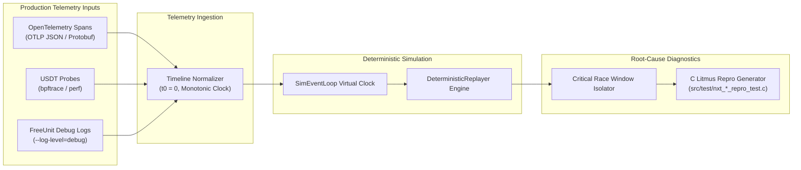

# Production Telemetry & Deterministic Trace Replay

The replay subsystem (`src/unit_model/replay/`) transforms real-world production telemetry into deterministic, reproducible discrete-event simulation runs, enabling post-mortem root-cause analysis and automatic synthesis of standalone C regression tests.

---

## 1. Pipeline Architecture



---

## 2. Ingestion Formats (`TelemetryIngestor`)

- **OpenTelemetry (OTLP)**: Ingests spans exported by `src/nxt_otel.c` and `src/otel/src/lib.rs`, extracting attributes (`http.status_code`, `http.method`, `unit.stream_id`, `unit.engine_id`) and nanosecond timestamps.
- **USDT DTrace / eBPF Probes**: Parses kernel/user probe trace outputs from `freeunit:queue__enqueue`, `freeunit:mmap__alloc`, `freeunit:worker_crash`.
- **Debug Logs**: Extracts stream IDs, HTTP statuses, and sequential transitions from FreeUnit debug outputs.

---

## 3. Deterministic Replay (`DeterministicReplayer`)

Maps production events to virtual clock ticks, reproducing interleavings that triggered historical bugs (such as #195 SIGKILL double-free, #573 dual-channel inversion, or #708 doorbell starvation).

```python
from unit_model.replay import TelemetryIngestor, DeterministicReplayer

ingestor = TelemetryIngestor()
events = ingestor.ingest_otlp_json(raw_spans_json)

replayer = DeterministicReplayer(num_engines=2, num_workers=4)
replayer.load_events(events)
summary = replayer.replay_all()

print(f"Replayed {summary.replayed_events} events, detected {len(summary.anomalies)} anomalies")
```

---

## 4. Root-Cause Analysis & C Litmus Synthesis (`RootCauseAnalyzer`)

Upon detecting an anomaly, the analyzer isolates the narrow temporal window ($\pm 20\,\mu\text{s}$) surrounding the event and synthesizes an executable C test case:

```python
from unit_model.replay import RootCauseAnalyzer

analyzer = RootCauseAnalyzer(summary, events)
critical_events = analyzer.isolate_critical_race_window()
c_test = analyzer.generate_c_litmus_test("nxt_race_repro_test", "dual_channel_inversion")
```
